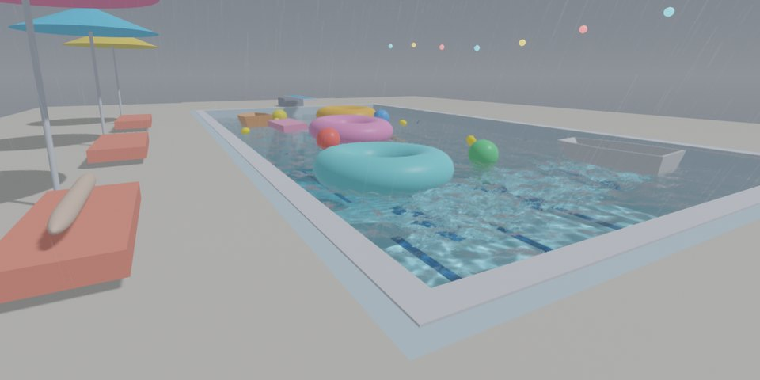
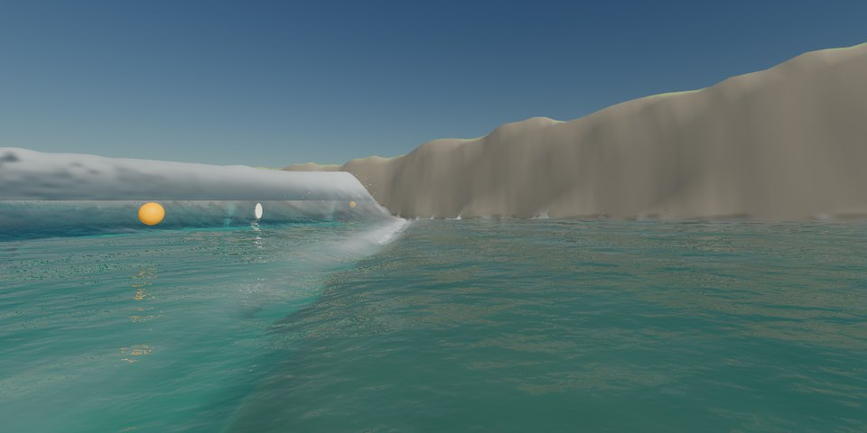
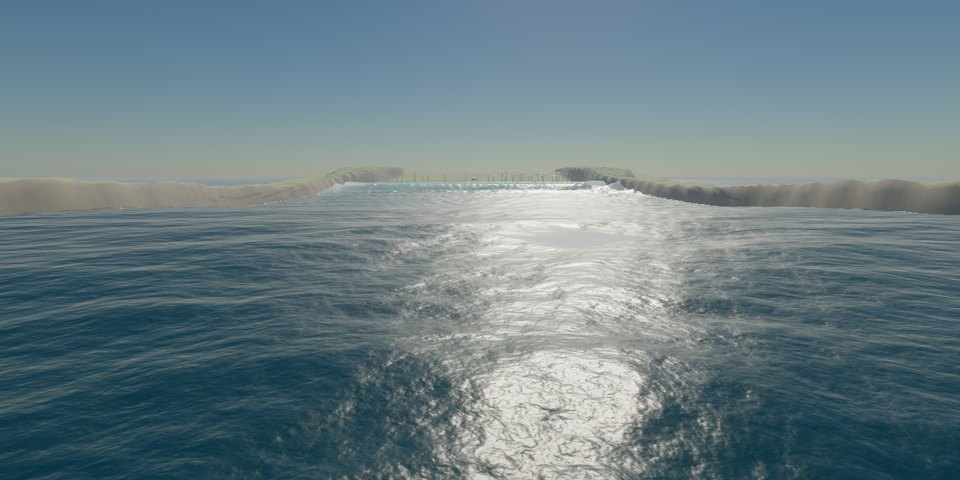
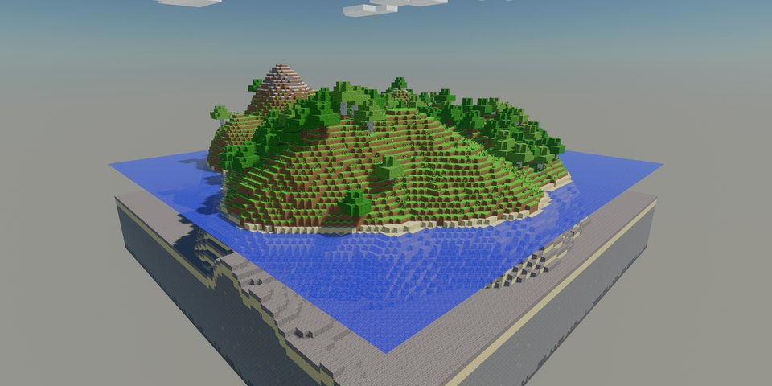

#  Amoris

Amoris is an agent-native 3D game engine with a Rust host, TypeScript gameplay, and desktop and web editors.
The editor, CLI, and agents share one command API. A wgpu renderer runs natively
on Metal, Vulkan, and Direct3D 12, and in the browser on WebGPU.

[Showcase](https://qiulinfan.github.io/amoris/) ·
[Editor guide](https://qiulinfan.github.io/amoris/documentation/editor/) ·
[Script API](https://qiulinfan.github.io/amoris/documentation/sdk/) ·
[CLI and MCP](https://qiulinfan.github.io/amoris/documentation/api/) ·
[Measurements](https://qiulinfan.github.io/amoris/documentation/data/) ·
[Profiling guide](https://qiulinfan.github.io/amoris/documentation/profiling/)

## Highlights

- **One command surface for people and agents.** The editor, the CLI, HTTP and MCP issue the same
  undoable commands. Games can declare player seats, so an agent plays through the perception and
  actions the game grants it, while developer edits stay refused.
- **Deterministic simulation.** Bevy ECS with Rapier in enhanced-determinism mode. Snapshots,
  input replay, forks and time travel work on one self-contained world, natively and in the browser.
- **TypeScript gameplay with a real debugger.** Stateless systems run on QuickJS-ng, hot-update at a
  tick boundary, and stop at breakpoints with locals, watches and source-level stepping.
- **A modern renderer.** GPU-driven culling with two-phase Hi-Z occlusion, an adaptive depth
  prepass, clustered PBR, cascaded shadows, TAA with upscaling, GTAO, sorted transparency and
  transmission, mesh levels of detail, baked probe GI and 3D Gaussian splats, natively and in
  WebGPU; ray-traced shadows and water reflections on native GPUs with ray queries.
- **Interactive GPU water.** Shallow-water regions solved on the GPU with non-hydrostatic pressure,
  breaking waves, falling sheets, wind, rain and an FFT wind sea, coupled to floating bodies, hulls
  and swimmers. The kernels compute the same bits on every GPU and in the browser, so water replays
  like the rest of the world.
- **Ships to the web.** `cargo xtask export-web` turns a game into a static WebGPU folder for hosts
  such as itch.io.

## The editor


*Pool party running in the web editor against the real Rust host: the WebGPU viewport, the
Hierarchy, the Inspector on the selected dinghy, the asset browser, Console, Events, Timeline,
Profiler and Debug panels, History and the Agent panel.*

The editor combines the engine's WebGPU viewport with a Monaco script editor, a debugger, an
undoable History, a Timeline and a Profiler that adds the viewport's GPU passes to the game
thread's systems. Play runs in a fork; **Stop** returns to the edit world. Edits made in the editor
and commands sent by agents enter the same history.

## Water and worlds

| | |
| --- | --- |
|  |  |
| [Pool party](samples/pool-party): floats, dinghies and swimmers on GPU water, with rain rings and caustics. | [Surf beach](samples/surf-beach): a 2.4 m swell trips on a reef and breaks along it. |
|  |  |
| The surf beach's water region joins an FFT wind sea that runs to the horizon. | [Blockcraft](samples/blockcraft): a voxel island whose water floods, pours and drains. |

These frames come from the current build on Apple M5 / Metal, through the headless capture
examples (`scene_shots`, `shore_shots`, `ocean_shots`) and `amoris serve`.

## Start the desktop editor

The desktop app opens projects in its own window, with a native folder picker, recent
projects, and application menus. It starts and stops the Rust host for you. The app
includes the engine, WebGPU viewport, and TypeScript checker.

Install [Rust](https://rustup.rs/), [Bun](https://bun.sh/), and [Node.js](https://nodejs.org/),
then build from the repository:

```sh
cd sdk && bun install --frozen-lockfile
cd ../editor && bun install --frozen-lockfile && bun run build
cd ..
cargo build --release -p amoris-app
cd desktop && npm ci
npm start -- ../samples/sailing
```

To create a local macOS application bundle, run `npm run package` in `desktop/`.
Open **Amoris.app** from `out/desktop/`; choose a folder containing `project.toml`.
**Cmd/Ctrl+O** switches projects. The app asks before discarding unsaved edits.
See the [desktop build guide](docs/spec/desktop.md) for packaging options.

## Start the web editor

Install [Rust](https://rustup.rs/) and [Bun](https://bun.sh/). The repository pins its
Rust toolchain in [rust-toolchain.toml](rust-toolchain.toml).

```sh
git clone https://github.com/qiulinfan/amoris.git
cd amoris

cd sdk
bun install --frozen-lockfile
cd ../editor
bun install --frozen-lockfile
bun run build
cd ..

cargo build --release -p amoris-app
./target/release/amoris serve samples/pool-party --editor editor/dist
```

Open **http://127.0.0.1:7878/** and press **Play**. The executable is currently named
`amoris`. The browser viewport requires WebGPU.

Select an entity in the Hierarchy to edit its components. Open a script under `scripts/` to
change its gameplay; **Cmd/Ctrl+S** applies the script. Set a breakpoint in the gutter,
then use **F5**, **F10**, and **F11** to continue, step over, and step into. **Stop**
returns to the original edit world. See the [editor guide](site/content/editor.md).

For a native game window, where `--walk` plays the first-person seat:

```sh
./target/release/amoris play samples/river-falls --walk
./target/release/amoris play samples/blockcraft --walk
./target/release/amoris play samples/sailing
```

## Samples

| Project | Demonstrates |
| --- | --- |
| [Pool party](samples/pool-party) | Floats, swimmers, dinghies and rain on GPU water |
| [River falls](samples/river-falls) | A river over a fall into a pool, ridden on an inner tube |
| [Surf beach](samples/surf-beach) | Swell shoaling into breakers over a reef, surfed on a board |
| [Water storm](samples/water-storm) | A harbour under a gale: wind set-up, rain, a wind sea and traced reflections |
| [Water valley](samples/water-valley) | Terrain and water declared in the scene, without a build script |
| [Water pool](samples/water-pool) | Swimming to a marker and back through real player input |
| [Blockcraft](samples/blockcraft) | A voxel island: break and place blocks; shallow water floods, pours and drains |
| [Town walk](samples/town-walk) | The ORCA Bistro exterior walked natively with collision and baked lighting; the third-party model is prepared locally and not committed |
| [Sailing](samples/sailing) | Wind, buoyancy, boat controls, and cargo collection |
| [Sailing course](samples/sailing-course) | Restricted player perception, intentions, and decision points |
| [Animation](samples/anim) | Animation, particles, and in-game UI |

`cargo xtask export-web <project> --zip FILE` packs any of them as a static WebGPU game
([web export](docs/spec/web-export.md)).

## API and agents

Discover commands and inspect a running game:

```sh
./target/release/amoris help
./target/release/amoris catalog --host http://127.0.0.1:7878 --json
./target/release/amoris world tree --host http://127.0.0.1:7878
./target/release/amoris call capture '{"position":[0,8,12],"look_at":[0,0,0]}' --host http://127.0.0.1:7878
```

Use `./target/release/amoris mcp samples/sailing` as a stdio MCP server, or connect to
the running host at `http://127.0.0.1:7878/mcp`. These tools expose the developer
command surface. Games that declare player seats also expose engine-enforced perception
and intention commands. For example, `amoris mcp samples/sailing-course --seat skipper`
exposes only the player tool; developer edits and debugger commands are refused.
See the [player workflow](site/content/api.md#play-through-a-restricted-seat).

- [Script API](site/content/sdk.md): components, queries, systems, events, and types.
- [CLI and MCP](site/content/api.md): discovery, world edits, time, capture, and debugging.
- [Host protocol](docs/spec/host-protocol.md): HTTP calls, WebSocket feeds, and schemas.

In the **5 October 2026** experiments, DeepSeek Flash played the detailed sailing course through
a player gateway and its native replay matched every recorded action and the final world hash
([agent report](site/content/agents.md)). A frozen six-task development benchmark through native
MCP tools passed **18/18 patches** on behavior, regression, type and integrity checks.

## Rendering research


*Bistro exterior, path-traced offline with multi-bounce lighting: 512 spp and a 12-bounce limit.
[Amazon Lumberyard / ORCA](https://developer.nvidia.com/orca/amazon-lumberyard-bistro), CC BY 4.0;
[asset credits](site/content/credits.md).*

Beside the interactive renderer, Amoris carries research tracers on every backend with ray
queries: a static-surface path tracer with an online neural radiance cache, world-space probe
baking and learned diffuse fields ([path tracing and NRC](docs/spec/path-tracing-nrc.md),
[Metal GI](docs/spec/metal-gi.md)), and neural texture compression
([neural textures](docs/spec/neural-textures.md)). The water's reflections and the sun's shadows
can be ray-traced in the interactive renderer (`AMORIS_RT_REFLECTIONS=1`, `AMORIS_RT_SHADOWS=1`).

## Measurements and profiling

Performance is measured and recorded, never a pass condition. Each study names its scene,
hardware, resolution and timing method:

- [Depth prepass](docs/bench/prepass.md): on a dense 1.6-million-cube scene at 2560 × 1440 with 4×
  MSAA, forcing the prepass on cut the RTX 5060 Laptop's GPU pass sum from 51.33 to 16.22 ms on
  Direct3D 12; auto mode probes both paths and keeps the cheaper one.
- [Forward renderer at scale](site/content/data.md): 1,024 Flight Helmets, 97 million scene
  triangles before culling, at 1920 × 1080 on Apple M5 / Metal.
- [Water](docs/bench/liquids.md), [physics](docs/bench/physics.md), [web rendering](docs/bench/web.md),
  [Metal profiling](docs/bench/metal-profiling.md) and the [GPU matrix](docs/bench/gpu-matrix.md).

`AMORIS_TRACE` writes CPU spans and timestamped GPU passes as a Perfetto trace; the
[profiling guide](https://qiulinfan.github.io/amoris/documentation/profiling/) explains how to
read CPU wall time, GPU frame spans and pass sums. Sanitized run data lives in
[amoris-benchmarks-results](https://github.com/qiulinfan/amoris-benchmarks-results).

## The small technology map

| Responsibility | Technology |
| --- | --- |
| Host and entities | Rust · Bevy ECS |
| Gameplay | TypeScript 7 · oxc · QuickJS-ng |
| Physics | Rapier 3D with enhanced determinism · GPU shallow water |
| Rendering | wgpu · WGSL · Metal / Vulkan / Direct3D 12 / WebGPU |
| Editor | React · dockview · Monaco · Electron (desktop) |
| Automation | CLI · HTTP / WebSocket · MCP |

Game state lives in components. Scripts run as stateless systems, and the renderer
reads the simulation's output. Snapshots, replay, and explicit forks operate on the
same self-contained world.

Metal is the macOS default and Direct3D 12 the Windows default when DXC 1.8.2502 or newer is
found (the Windows SDK, or `AMORIS_DXC`), Vulkan there otherwise; `AMORIS_BACKEND=vulkan`
selects Vulkan anywhere.

## License

Amoris is released under the [MIT License](LICENSE). Third-party dependencies and
showcase assets retain their own licenses and attribution.
