# 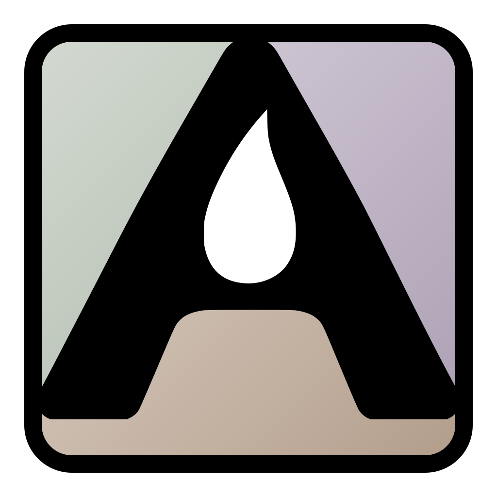 Amoris

Amoris is an agent-native 3D game engine with a Rust host, TypeScript gameplay, and desktop and web editors.
The editor, CLI, and agents share one command API. A wgpu renderer runs natively
on Metal, Vulkan, and Direct3D 12, and in the browser on WebGPU.

[Showcase](https://qiulinfan.github.io/amoris/) ·
[Editor guide](https://qiulinfan.github.io/amoris/documentation/editor/) ·
[Script API](https://qiulinfan.github.io/amoris/documentation/sdk/) ·
[CLI and MCP](https://qiulinfan.github.io/amoris/documentation/api/) ·
[Measurements](https://qiulinfan.github.io/amoris/documentation/data/) ·
[Profiling guide](https://qiulinfan.github.io/amoris/documentation/profiling/)

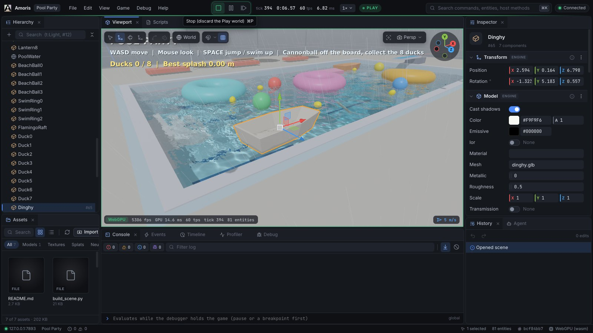

<sub>The web editor playing Pool party against the real Rust host.</sub>

## Scenes

Work in progress: engine captures on Apple M5 / Metal ([asset credits](site/content/credits.md)).

<table>
<tr><td width="33%">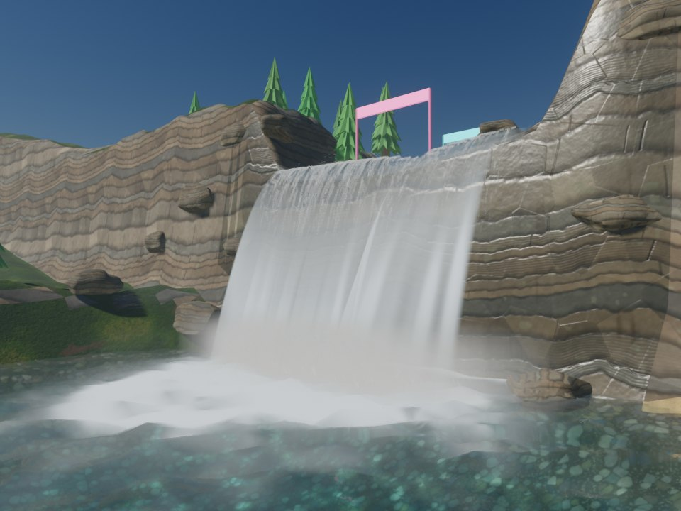<br><a href="samples/river-falls">River falls</a></td><td width="33%">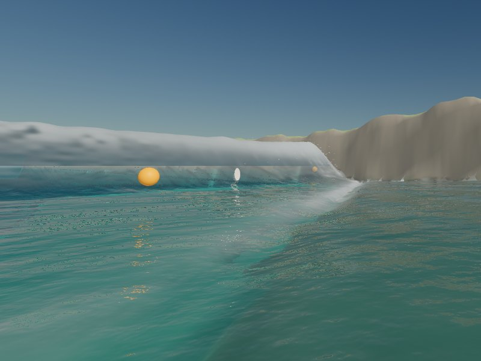<br><a href="samples/surf-beach">Surf beach</a></td><td width="33%">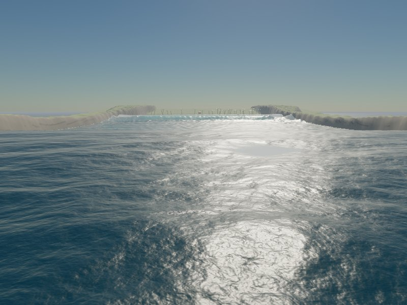<br>Wind sea</td></tr>
<tr><td width="33%">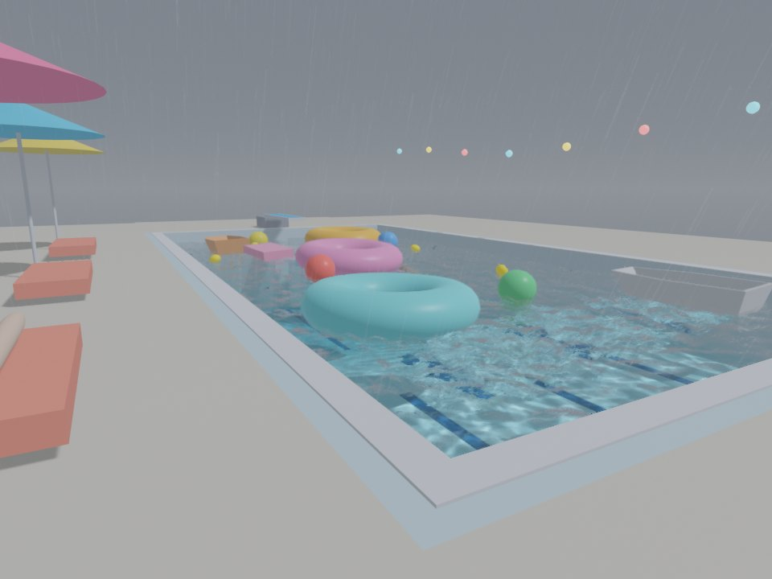<br><a href="samples/pool-party">Pool party</a></td><td width="33%">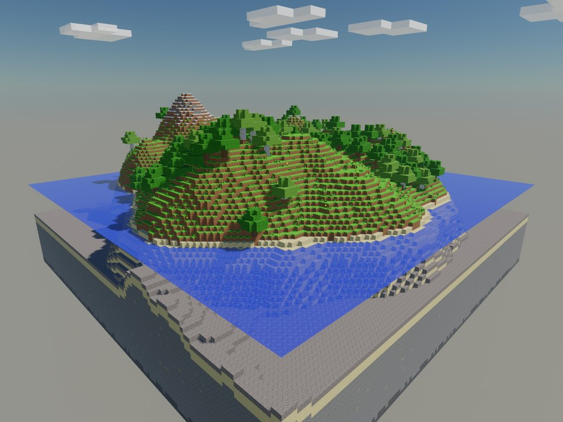<br><a href="samples/blockcraft">Blockcraft</a></td><td width="33%">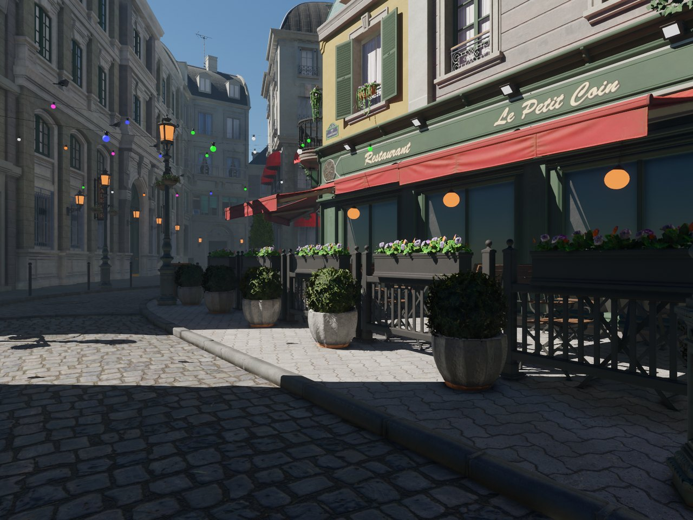<br><a href="samples/town-walk">Bistro</a>, real-time</td></tr>
<tr><td width="33%">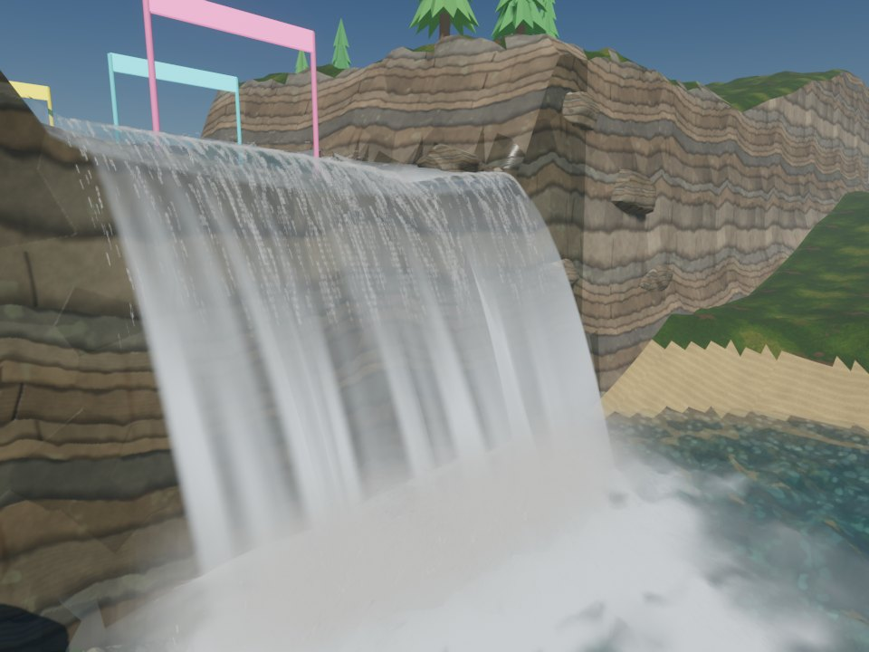<br>Falls, from the pool</td><td width="33%">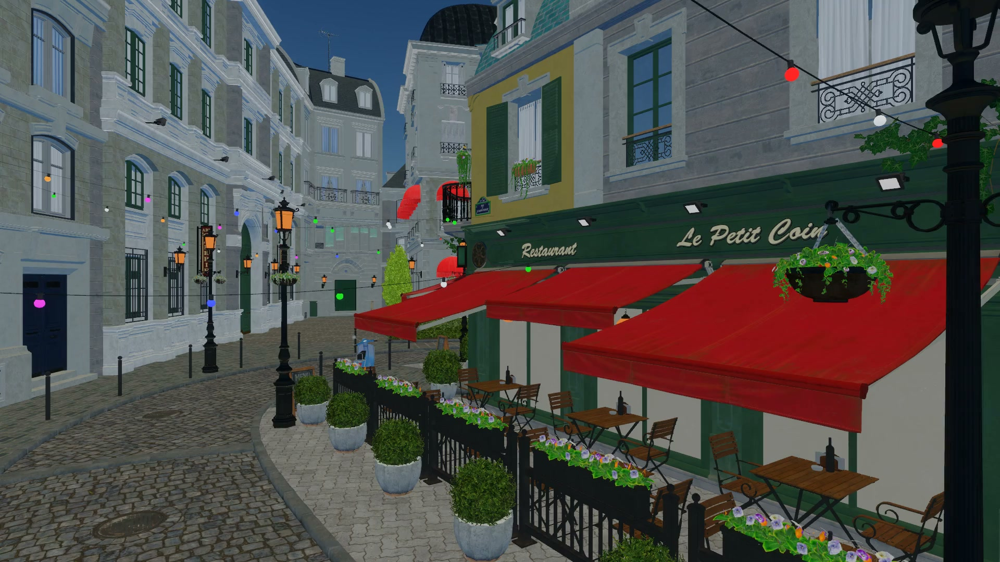<br>Bistro, path-traced</td><td width="33%">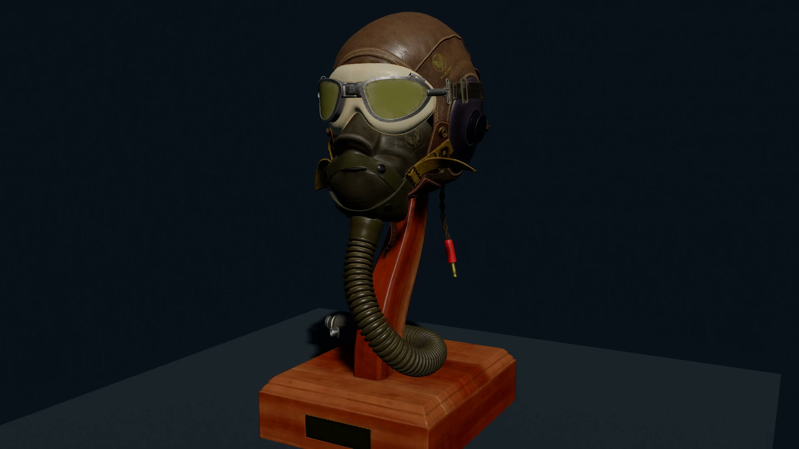<br>Flight Helmet</td></tr>
</table>

## Highlights

- **One command surface** for the editor, the CLI, HTTP and MCP; agents can play through
  engine-enforced player seats.
- **Deterministic simulation**: snapshots, replay, forks and time travel, natively and in the browser.
- **TypeScript gameplay** on QuickJS-ng, hot-updated at a tick boundary, with a source-level debugger.
- **A modern renderer** on Metal, Vulkan, Direct3D 12 and WebGPU: GPU culling, TAA, GTAO, baked
  GI, splats, and ray-traced shadows and reflections where the GPU has ray queries.
- **GPU water** that computes the same bits on every device, so it replays with the world.
- **Web export** of any game as a static WebGPU folder.

## Start the desktop editor

The desktop app opens projects in its own window, with a native folder picker, recent
projects, and application menus. It starts and stops the Rust host for you. The app
includes the engine, WebGPU viewport, and TypeScript checker.

Install [Rust](https://rustup.rs/), [Bun](https://bun.sh/), and [Node.js](https://nodejs.org/),
then build from the repository:

```sh
cd sdk && bun install --frozen-lockfile
cd ../editor && bun install --frozen-lockfile && bun run build
cd ..
cargo build --release -p amoris-app
cd desktop && npm ci
npm start -- ../samples/sailing
```

To create a local macOS application bundle, run `npm run package` in `desktop/`.
Open **Amoris.app** from `out/desktop/`; choose a folder containing `project.toml`.
**Cmd/Ctrl+O** switches projects. The app asks before discarding unsaved edits.
See the [desktop build guide](docs/spec/desktop.md) for packaging options.

## Start the web editor

Install [Rust](https://rustup.rs/) and [Bun](https://bun.sh/). The repository pins its
Rust toolchain in [rust-toolchain.toml](rust-toolchain.toml).

```sh
git clone https://github.com/qiulinfan/amoris.git
cd amoris

cd sdk
bun install --frozen-lockfile
cd ../editor
bun install --frozen-lockfile
bun run build
cd ..

cargo build --release -p amoris-app
./target/release/amoris serve samples/pool-party --editor editor/dist
```

Open **http://127.0.0.1:7878/** and press **Play**. The executable is currently named
`amoris`. The browser viewport requires WebGPU.

Select an entity in the Hierarchy to edit its components. Open a script under `scripts/` to
change its gameplay; **Cmd/Ctrl+S** applies the script. Set a breakpoint in the gutter,
then use **F5**, **F10**, and **F11** to continue, step over, and step into. **Stop**
returns to the original edit world. See the [editor guide](site/content/editor.md).

For a native game window, where `--walk` plays the first-person seat:

```sh
./target/release/amoris play samples/river-falls --walk
./target/release/amoris play samples/blockcraft --walk
./target/release/amoris play samples/sailing
```

## Samples

| Project | Demonstrates |
| --- | --- |
| [Pool party](samples/pool-party) | Floats, swimmers, dinghies and rain on GPU water |
| [River falls](samples/river-falls) | A river over a fall into a pool, ridden on an inner tube |
| [Surf beach](samples/surf-beach) | Swell shoaling into breakers over a reef, surfed on a board |
| [Water storm](samples/water-storm) | A harbour under a gale: wind set-up, rain, a wind sea and traced reflections |
| [Water valley](samples/water-valley) | Terrain and water declared in the scene, without a build script |
| [Water pool](samples/water-pool) | Swimming to a marker and back through real player input |
| [Blockcraft](samples/blockcraft) | A voxel island: break and place blocks; shallow water floods, pours and drains |
| [Town walk](samples/town-walk) | The ORCA Bistro exterior walked natively with collision and baked lighting; the third-party model is prepared locally and not committed |
| [Sailing](samples/sailing) | Wind, buoyancy, boat controls, and cargo collection |
| [Sailing course](samples/sailing-course) | Restricted player perception, intentions, and decision points |
| [Animation](samples/anim) | Animation, particles, and in-game UI |

`cargo xtask export-web <project> --zip FILE` packs any of them as a static WebGPU game
([web export](docs/spec/web-export.md)).

## API and agents

Discover commands and inspect a running game:

```sh
./target/release/amoris help
./target/release/amoris catalog --host http://127.0.0.1:7878 --json
./target/release/amoris world tree --host http://127.0.0.1:7878
./target/release/amoris call capture '{"position":[0,8,12],"look_at":[0,0,0]}' --host http://127.0.0.1:7878
```

Use `./target/release/amoris mcp samples/sailing` as a stdio MCP server, or connect to
the running host at `http://127.0.0.1:7878/mcp`. These tools expose the developer
command surface. Games that declare player seats also expose engine-enforced perception
and intention commands. For example, `amoris mcp samples/sailing-course --seat skipper`
exposes only the player tool; developer edits and debugger commands are refused.
See the [player workflow](site/content/api.md#play-through-a-restricted-seat).

- [Script API](site/content/sdk.md): components, queries, systems, events, and types.
- [CLI and MCP](site/content/api.md): discovery, world edits, time, capture, and debugging.
- [Host protocol](docs/spec/host-protocol.md): HTTP calls, WebSocket feeds, and schemas.

## Rendering research

Path tracing with an online neural radiance cache, probe baking and learned diffuse fields, and
neural texture compression: [path tracing and NRC](docs/spec/path-tracing-nrc.md),
[Metal GI](docs/spec/metal-gi.md), [neural textures](docs/spec/neural-textures.md).

## Measurements and profiling

Measured and recorded, never a pass condition: [benchmarks and methods](https://qiulinfan.github.io/amoris/documentation/data/),
the [profiling guide](https://qiulinfan.github.io/amoris/documentation/profiling/), and raw data in
[amoris-benchmarks-results](https://github.com/qiulinfan/amoris-benchmarks-results).

## The small technology map

| Responsibility | Technology |
| --- | --- |
| Host and entities | Rust · Bevy ECS |
| Gameplay | TypeScript 7 · oxc · QuickJS-ng |
| Physics | Rapier 3D with enhanced determinism · GPU shallow water |
| Rendering | wgpu · WGSL · Metal / Vulkan / Direct3D 12 / WebGPU |
| Editor | React · dockview · Monaco · Electron (desktop) |
| Automation | CLI · HTTP / WebSocket · MCP |

Game state lives in components. Scripts run as stateless systems, and the renderer
reads the simulation's output. Snapshots, replay, and explicit forks operate on the
same self-contained world.

Metal is the macOS default and Direct3D 12 the Windows default when DXC 1.8.2502 or newer is
found (the Windows SDK, or `AMORIS_DXC`), Vulkan there otherwise; `AMORIS_BACKEND=vulkan`
selects Vulkan anywhere.

## License

Amoris is released under the [MIT License](LICENSE). Third-party dependencies and
showcase assets retain their own licenses and attribution.
