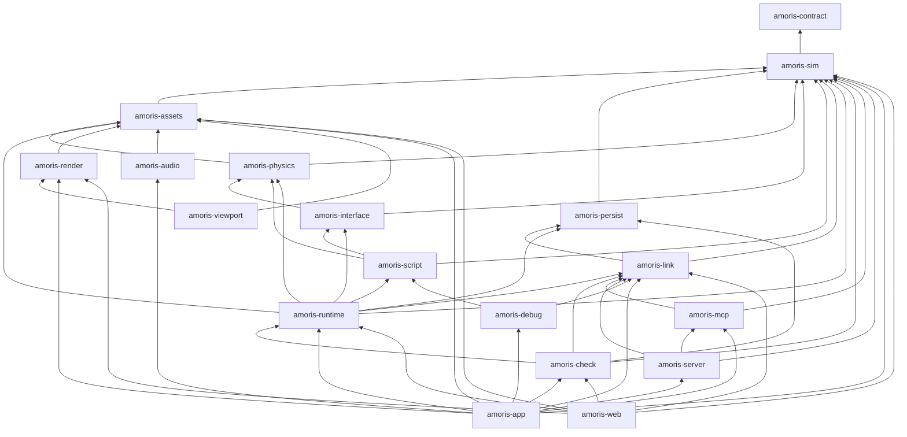

# Architecture: the Rust workspace

Status: Draft, slice 0; brought in line with the code on 2026-10-25: the crate entries say what is
built, and what is not yet built is marked planned.

Charter: 3.8 (crates with one-way dependencies), 4.1 (stack and the `wasm32` build from day one),
4.2 (where transpiling, loading and `.d.ts` generation sit), 4.4 (rendering as a projection), 5.1 to
5.3 (the crates, the native threads and the web, detailed in `threads.md`), 5.4 (the repository's
layout).

This specification fixes the crates of the rebuild's Rust workspace: what each owns and exports,
which crates each may depend on, which external crates may appear where, how C code inside the
workspace is compiled, and how each crate builds for `wasm32`. It does not define the concepts the
crates hold; those belong to the specifications named below, and this file only says which crate
carries them. `threads.md` specifies the game and presenter threads that run on these crates,
`checks.md` the local check command that enforces this layout, and `budgets.md` the performance
measurements and their reference figures.

GPU water (owner's direction, 2026-10-19; [water.md](water.md) 17) adds a host-injected compute
service without changing the crate edges. `amoris-physics` owns the service interface and world
state, `amoris-runtime` exposes the installation interface, `amoris-render` owns the wgpu kernels,
and `amoris-app` adapts them at game construction. The service receives only a borrowed numeric
grid. The browser uses the same kernels through `amoris-web::gpu_water`, on its Web Worker's own
device, with owned requests queued by the game and async completion through `Game::poll_step`.
The host has no access to the game world. The GPU's buffers are scratch; f64 components continue
to carry the complete checkpoint state, with the explicit GPU mode's narrower determinism scope.

## 1. Related specifications

| Owner | Concepts used here by name | File |
|---|---|---|
| spec-sim | Tick, the fixed timestep, system order, events, EntityId and its allocation, iteration order, numeric rules, the deterministic math library, the RNG | [simulation.md](simulation.md), [numeric.md](numeric.md), [rng.md](rng.md) |
| spec-persist | canonical serialization (PCE), the world hash, snapshot, restore, fork, replay, the first divergence, script and data versions, migrations | [persistence.md](persistence.md), [replay.md](replay.md), [versions.md](versions.md) |
| spec-script | the script host API, module loading, transpiling, the global freeze, the lint, the execution budget, `.d.ts` generation, project components, hot update | [script-host.md](script-host.md), [script-sandbox.md](script-sandbox.md), [hot-update.md](hot-update.md) |
| spec-contract | perception, actions and affordances, players (seats) and observers, time modes and the time controller, the error protocol (`{code, message, detail}`, the Rust type `Problem`), the `amoris-contract` types crate | [shared/contract/](../../shared/contract/README.md): [perception.md](../../shared/contract/perception.md), [actions.md](../../shared/contract/actions.md), [time.md](../../shared/contract/time.md), [errors.md](../../shared/contract/errors.md) |
| spec-mcp | the MCP tools, the benchmark | [shared/contract/mcp.md](../../shared/contract/mcp.md), [shared/benchmark/](../../shared/benchmark/README.md) |
| spec-arch (this agent) | crates, threads, the check command, budgets, the web build | `architecture.md`, `threads.md`, `checks.md`, `budgets.md` |

The shared contract and benchmark live under this repository's `shared/`; the other
specifications are beside this one in `docs/spec/`.

## 2. Principles of the layout

1. **The headless core builds alone.** Every crate the game thread runs (simulation, persistence,
   physics, perception and action, scripts, the runtime) builds and runs without `wgpu`, `winit`,
   `egui` or an async runtime. A server, a benchmark process and the browser's game worker link only
   these. The check enforces it on the transitive dependency graph (`checks.md`, deps).
2. **Presenters read the render feed; tools reach the game only through `amoris-link`.** The
   presenters (`amoris-render`, `amoris-audio`, `amoris-viewport`) read the world only through the
   render feed that `amoris-assets` defines (`amoris_assets::frame`), and the tools (`amoris-mcp`,
   `amoris-server`, `amoris-debug`) send commands and read snapshots through the types of
   `amoris-link` (`threads.md`), the debugger also through the script host's debug hook (4.17). None
   of them links the runtime, so none can mutate the world by construction, which is what charter
   4.4 asks of rendering (what the GPU holds is derived, never simulation state). The editor is not
   a crate: it speaks the host protocol (charter 4.5; 4.11). The renderer's GPU water kernels do
   compute world state, but only behind `amoris-physics`'s service interface, installed by the app
   crates; no game crate calls the renderer (5).
3. **One-way dependencies, declared.** The allowed edges between workspace crates are listed in
   `tools/crate-graph.toml`, which mirrors section 5; a new crate or a new edge is a deliberate
   change to both, reviewed like any architecture decision.
4. **Every game-side crate builds for `wasm32` from its first commit** (charter 4.1). Crates that
   cannot (the MCP server, the debugger endpoint, the check orchestrator) are marked native-only in
   the graph file.
5. **Cohesive modules.** Modules split by responsibility (rendering by pass or feature, charter
   4.4); file size follows readability, with no line limit (charter 3.8).
6. **Concepts live where their owner says, code lives where the dependency graph allows.** When a
   concept is needed below the crate that owns its behavior (for example the per-type persistence
   traits, which physics and scripts implement without depending on persistence), the type-level
   hook sits in the lower crate and the owning specification still defines it.

## 3. Repository layout

The repository's top level. `crates/` is flat: each crate's group, which opens its line below, is
declared in `tools/crate-graph.toml` (section 5), not by a folder. The rules behind this layout are
charter 5.4; generated files are committed with their generator and regenerated, never edited, and
run output goes to the ignored `out/`.

```text
Cargo.toml            workspace: shared/contract/rust, crates/*, xtask; the pins in
                      [workspace.dependencies] (6)
Cargo.lock            committed
rust-toolchain.toml   Rust 1.98.1 with rustfmt and clippy; targets wasm32-unknown-unknown and
                      wasm32-wasip1
.cargo/config.toml    alias xtask; [env] CFLAGS for C code (7.3); [patch.crates-io] rquickjs-sys
.github/workflows/    pages.yml: builds site/ into the Pages artifact (tools/site/build_site.py)
AGENTS.md  CLAUDE.md  rules for agents working here (CLAUDE.md includes AGENTS.md)
README.md  LICENSE    the introduction for people; MIT
crates/
  amoris-sim/         game: ECS world, tick, schedule, entity ids, events, RNG, deterministic
                      math, component registry, block volumes (4.1)
  amoris-assets/      game: asset identity, visual components, CPU meshes, glTF import, the render
                      feed that carries visual changes to the renderers (4.2)
  amoris-persist/     game: canonical encoding, world hash, snapshot, fork, replay, versions (4.3)
  amoris-physics/     game: Rapier bodies, buoyancy, wind and sails, hydrodynamics, the
                      first-person body, shallow water and the GPU water service interface (4.4)
  amoris-interface/   game: perception, actions and affordances, time modes, player seats (4.5)
  amoris-script/      game: TypeScript on QuickJS-ng; the `amoris` module is src/prelude/ (4.6)
  amoris-runtime/     game: composition, command catalog, scenes, game thread, render-feed
                      extraction (4.8)
  amoris-check/       game: determinism, fork, replay and reload checks over one project (4.9)
  amoris-link/        link: snapshots, events and commands between the game thread and its
                      clients (4.7)
  amoris-render/      presenter: the wgpu renderer, its native window and research tracers, and
                      the GPU water kernels; WGSL in shaders/ beside the code (4.10)
  amoris-audio/       presenter: kira playback of sound sources and events, the water's sound;
                      native only (4.19)
  amoris-viewport/    presenter: the renderer in the browser (WebGPU), built into the committed
                      web/viewport/pkg (4.20)
  amoris-mcp/         tool: the command catalog as MCP tools over stdio and HTTP (4.12)
  amoris-server/      tool: the host's loopback server: the editor, /ws, /api, /assets, /render,
                      /mcp (4.18)
  amoris-debug/       tool: the script debugger, its CDP endpoint and agents' API (4.17)
  amoris-app/         app: the native binary `amoris`: play, run, serve, mcp, check, replay and
                      the client of a running host (4.13)
  amoris-web/         app: the browser game module, worker and page roles, built into web/pkg
                      (4.14)
  engine_version.rs   the engine source hash, included by amoris-app's and amoris-web's build
                      scripts; everything under crates/ enters it (4.13)
shared/               the shared contract (prose; contract/rust is amoris-contract, 4.16) and
                      benchmark prose; contract/README.md states the contract's version
third_party/          rquickjs-sys-0.14.0/ (patched, committed), patches/ (PR #1421 and P1 to
                      P13), vendor.py that rebuilds it (7.5)
xtask/                cargo xtask: check, gen, webcheck, export-web (4.15)
editor/               the React web editor (4.11): src/, mock/ (the mock host), test/, tools/
                      (headless-Chrome harnesses, run from editor/)
desktop/              the Electron shell around the same editor (desktop.md)
web/                  browser pages: index.html (the browser-local run form; ?check runs the web
                      check), play.html and player.js (the player that export-web copies),
                      amoris.js and game.js (the page's handle and the game worker),
                      viewport/ (the renderer's glue and its committed pkg/);
                      pkg/ and projects/ are built by tools/build_web.sh and ignored
sdk/                  the TypeScript 7 toolchain that scripts.check finds (package.json, bun.lock)
samples/              game projects, one folder each with project.toml, scene.json and scripts/;
                      xtask runs every samples/*/check.toml (checks.md 8.1)
  blockcraft/         voxel sandbox island with shallow water (from qiulinfan/amoris-samples)
  sailing/            the sailing showcase; sailing-course/ is its player course
  anim/               skinned glTF characters
  town-walk/          the Bistro exterior walked natively; its third-party model is ignored
  pool-party/  river-falls/  surf-beach/  water-pool/  water-storm/  water-valley/
                      games and demos on resident GPU water, each with a README
tests/fixtures/       projects only tests and checks read: controls/ (the checks' negative
                      controls), sdk/ (the SDK's type test), and scenes/ that tests, checks and
                      measurement tools read, with their generators beside them
  scenes/             water-dam/  water-feedback/  water-floaters/  water-probes/
                      water-resident/  water-river/  water-shore/  water-slope/  gi-room/  pt-lab/
bench/                workloads and comparison harnesses: agent-dev/ (the Courier benchmark),
                      physics/ (Rapier, Jolt, PhysX through Unity), rules/ (the rule workload,
                      budgets.md 4), web/ (three.js many_cubes, threejs_cubes.html)
tools/                scripts by purpose (tools/README.md): render/ (renderer benches, compares
                      and captures), water/ (water checks, plots and benches), host/ (the
                      host, player and editor-loop probes and benches), runtime/ (game thread
                      and script benches), site/ (the Pages site and showcase captures), eval/
                      (agent evaluations), neural/ (training), splats/, tests/ (the tools' own
                      tests), vscode/ (the script debugger's VS Code attach configuration); at
                      the top what xtask, CI or several groups use: the check's inputs
                      crate-graph.toml, clippy-determinism.toml and lint-fixture/,
                      wrap_docs.py, webcheck.py, gpu_matrix.py with amd_vkcache.py,
                      build_viewport.sh, build_web.sh, package_game.py, amoris_rename.py and
                      the shared helpers machine_conditions.py, quiet_tables.py, web_bench.mjs
                      and web_readback.mjs
docs/                 charter.md, sdk.md, spec/, bench/ (methods and result tables),
                      spikes/, research/, imports/
site/                 the Pages showcase: landing page, MkDocs user docs (content/), capture
                      demos (demos/)
assets/branding/      the engine's icons and their source record
out/  target/         ignored: run output, logs and captures; cargo's builds
```

## 4. The crates

Each entry says what the crate owns (which specification defines it), what it exports, what it must
not do, and how it builds for `wasm32`. Exported names that another specification defines are
written as that specification names them.

### 4.1 `amoris-sim`: the simulation core

- **Owns**: the ECS world on `bevy_ecs` (ECS crate only, single-threaded executor; charter 4.1),
  Tick and the fixed timestep, the system schedule and its order, EntityId and its allocation,
  iteration order, the numeric rules and the deterministic math library (module `math`), the RNG,
  events and their dispatch (all spec-sim); the engine's plain-data component types and the
  component registry (names, versions, JSON Schemas through `schemars`, `.d.ts` through the
  generator spec-script names).
- **Exports**: `Sim` and its step hooks, `Tick`, `SimClock`, `EntityId`, events, the RNG, `math`,
  the component registry, the per-type persistence traits (`Persisted` and its relatives,
  persistence.md 6.2) and `ContentHash` (persistence.md 6.1). These two are declared here so that
  `amoris-physics`, `amoris-assets` and `amoris-script` register state and name content without
  depending on `amoris-persist`; spec-persist defines their contracts.
- **Must not**: read the wall clock, spawn threads, iterate a `HashMap` or `HashSet` where order
  reaches the world, call platform transcendental functions (the lists are simulation.md 10 and
  numeric.md 5; `checks.md`, clippy, enforces them), depend on any crate above it.
- **wasm32**: pure Rust; builds for `wasm32-unknown-unknown` with `bevy_ecs` without its
  `multi_threaded` feature.

### 4.2 `amoris-assets`: asset identity and geometry

- **Owns**: asset identity by content hash (spec-persist's `ContentHash`; a world refers to an asset
  by hash, so a replay names exactly the bytes it ran with), the cooked mesh format (positions,
  indices, LOD levels, bounds) that physics and rendering both read, and the glTF 2.0 importer with
  mesh optimization and LOD generation (`gltf`, `meshopt`; charter 4.4). Its own specification comes
  before slice 3; slice 0 only measures import (`budgets.md`, import).
- **Exports**: the cooked mesh type and its loader by `ContentHash`, the importer (feature
  `import`), and `read_data(path) -> Result<(Arc<[u8]>, ContentHash), Problem>`, the one function
  through which the game thread reads a data file by path and reports the `DataRead` to a running
  recorder (versions.md 3.3).
- **Must not**: touch the world; import runs on worker threads and its result enters the world as a
  command at a tick boundary (`threads.md`, 6), never by a side door. Master's OBJ import froze the
  runtime for 4.7 s on a 5M-triangle file, and moving it to a thread was left undone because loading
  behind its callers would have let the wall clock decide on which tick a collider or a bounds
  appears (master's rendering and import assessment of 2026-10-02, item 3); the command path solves
  both.
- **wasm32**: the loader of cooked assets builds for `wasm32-unknown-unknown`. The importer (feature
  `import`, which pulls meshoptimizer's C++) is native-only: the web build loads assets cooked
  natively, so it needs neither the importer nor a C++ standard library. The render spike did import
  in Chrome (four workers, 3.8 s for its 122 MB scene), but its workers shared the file through a
  `SharedArrayBuffer`, which needs the cross-origin isolation a shared link may lack, and each held
  its own copy of the file. Pioneer, 2026-10-09 (charter 4.4's note on mesh LOD): no
  cooked format exists yet, and the browser viewport (`amoris-viewport`) imports the `.glb` files it
  fetches with this importer in WebAssembly; at that checkpoint the game module (`amoris-web`)
  linked neither. Levels of detail are made at import there as natively: meshoptimizer (feature
  `lod`, which `import` enables) builds for `wasm32-unknown-unknown` with the stripped headers the
  `meshopt` crate ships, and needs no C++ standard library, only `operator new` and
  `operator delete`, which `amoris_assets::lod` supplies from Rust's allocator (docs/spec/lod.md 2).

### 4.3 `amoris-persist`: persistence

- **Owns**: canonical serialization, the world hash, snapshot and restore, in-memory fork, replay
  recording and verification, the first divergence, script and data versions, migrations (all
  spec-persist).
- **Exports**: the whole-world operations over the traits registered in `amoris-sim` (persistence.md
  6): `Snapshot` and `snapshot`, `restore`, `fork`, `world_hash`, the `Recorder` that
  `amoris-runtime` hands every applied write (`threads.md`, 5.3), `Replay` and `verify`, `lockstep`,
  `first_divergence` and `diff`, and the `Stepper` trait the runtime implements.
- **Must not**: depend on physics or scripts. Their state reaches it through the traits registered
  in `amoris-sim`. Migrations written in TypeScript run in the script host, which `amoris-runtime`
  links and offers to this crate as versions.md's `ProjectMigrator` (section 9).
- **wasm32**: pure Rust.

### 4.4 `amoris-physics`: physics and the showcase's forces

- **Owns**: the physics engine integration (`rapier3d` 0.36.0, which the physics spike found
  deterministic natively and in the browser, `docs/spikes/physics.md`; charter 4.7's choice,
  proposed in [README.md](README.md); the crate isolates it), and buoyancy, wind on the sail and
  hydrodynamics as engine systems (charter 5.1), with their components and the spatial queries
  (ray casts, overlaps) that perception and scripts use as general primitives (charter 4.2).
- **Exports**: a plugin function that registers its components, resources (with their persistence
  hooks, so fork and the world hash cover the solver's caches, charter 3.4) and systems into the
  schedule at the places spec-sim's system order names; the query functions.
- **Must not**: enable the solver's `simd8` or `parallel` features. `rapier3d` 0.36 refuses to
  compile `simd8` with `enhanced-determinism` because eight lanes break cross-platform determinism
  (a `compile_error!` at the top of its `src/lib.rs`); `parallel` is not refused but runs the solver
  on a `rayon` pool, which this layout keeps out of the tick (`threads.md`, 3.4). The check verifies
  the resolved features (`checks.md`, deps). Nor may it give a dynamic hull, trimesh or compound
  collider a density while Rapier's stack calls the platform's math natively for its mass properties
  (numeric.md 5).
- **wasm32**: pure Rust (`rapier3d` with `enhanced-determinism`).

### 4.5 `amoris-interface`: perception and action

- **Owns**: perception (observers, query forms, token budgets, the marked omniscient view), actions
  (controls, intents, affordance declarations, their error codes) and the time modes with
  pause-on-decision (all spec-contract), as implemented by this line.
- **Exports**: the perception queries, action validation and application into the world, the time
  model's answer to "what next" at each tick boundary (named `Pace` in `threads.md`, 3), and the
  Rust types from which the shared contract's schemas are generated (charter 4.1, script types).
- **Must not**: call into the script host. Script-defined intents and affordances reach it as data
  in the world (registries that scripts fill through the host API), so the dependency stays one-way
  and the state stays in the world (charter 3.3). This is a constraint on spec-contract and
  spec-script (section 9).
- **wasm32**: pure Rust.

### 4.6 `amoris-script`: the script host

- **Owns**: the script host API, module loading, transpiling with oxc, the global freeze, the lint,
  the execution budget, `.d.ts` generation, project components and hot update (all spec-script).
- **Exports**: the script host (a QuickJS-ng runtime and context through `rquickjs`), the bundle
  type, the transpile function (feature `transpile`), the `.d.ts` generator, and the systems that
  run script rules inside the schedule. It exposes perception (for non-player characters, charter
  3.2) and physics queries to scripts, hence its edges to `amoris-interface` and `amoris-physics`.
- **Must not**: keep state outside the world (charter 3.3); read the wall clock (the execution
  budget counts work, charter 4.2). A benchmark may inject a clock that times each script call's
  phases (`ScriptHost::time_phases`, script-host.md 9); its readings are never world state.
- **wasm32**: QuickJS-ng is C. The script-web spike (`docs/spikes/script-web.md`, Verdict and
  Recipe) built it for `wasm32-unknown-unknown` through `rquickjs` 0.14.0 with clang 23 and the
  wasi-libc subset `rquickjs-sys` vendors, defining the shim's one import (`__rquickjs_host_now_us`)
  in Rust so the module imports only `wasm-bindgen`'s glue, and setting the stack limit to 256 KiB,
  which wasm32 requires (section 8). The `transpile` feature (oxc) is off by default and enabled
  through `amoris-runtime`'s `transpile` by `amoris-app`; the shipped web build has it off, its
  scripts arriving transpiled in the web package. The type check (`tsc`, script-host.md 7.4) is a
  child process of `amoris-server` (`scripts.check`) and of `amoris check` (through `amoris-app`),
  never of a game crate, so `amoris-script` has no `typecheck` feature.
- **Threads**: the script host is not `Send` (rquickjs 0.14.0 implements `Send` only under its
  `parallel` feature, which pulls `tokio/rt-multi-thread`; `tools/crate-graph.toml` forbids that
  feature, section 10), so every thread that runs scripts builds its own host (script-host.md 9).

### 4.7 `amoris-link`: what crosses between the game and its presenters

- **Owns**: the snapshot type and its reader, the event stream, the command envelope with its source
  and sequence, the client handle that sends commands, the reply type, and the wire encoding of all
  of these for the web worker and network spectators (`threads.md`, 4 to 7).
- **Exports**: `WorldSnapshot` (spec-persist's `Snapshot` with what presenters need beside it),
  `SnapshotReader`, `SnapshotView` (typed and JSON decoding of sections through spec-persist's
  encoding and the component registry), `Envelope`, `Source`, `Kind`, `GameClient`, `Reply`,
  `EventRecord`, `EventCursor`, the `wire` module.
- **Must not**: depend on any crate but `amoris-sim` and `amoris-persist` (for the `Snapshot` type
  and decoding); it is what presenters link instead of the game.
- **wasm32**: pure Rust.

### 4.8 `amoris-runtime`: the game

- **Owns**: composition (a `Game` value that holds the world, the script host, physics, the
  interface state and the recorder), the command catalog (every command's name, kind, parameter and
  result types with their schemas, registered by the crate that implements it), applying commands at
  tick boundaries in the canonical order, the game thread on native targets, snapshot publication,
  hot-update preparation off the game thread (transpile on a worker, swap at a boundary), asset
  arrival as commands.
- **Exports**: `Game` (synchronous: `apply`, `step`, `fork`, `snapshot`; built with an injected
  clock, threads.md 3.1; used directly by the headless and batch forms and by every check; it
  implements spec-persist's `Stepper` and `ProjectMigrator`), `GameThread` (whose `spawn` takes a
  function that builds the `Game` on the new thread) and `GameHandle` (native only, feature
  `thread`), the catalog.
- **Must not**: depend on any presenter crate or on an async runtime; read a clock outside its
  loop-clock module (simulation.md 10).
- **wasm32**: builds without `GameThread`; on the web, `amoris-web`'s worker entry drives `Game`
  from the worker's message loop (`threads.md`, 7).

### 4.9 `amoris-check`: in-process checks

- **Owns**: the determinism, fork-consistency, replay and reload-equivalence runs over one project
  and the hash-chain comparison (`checks.md`). Planned: the measurement harness and its statistics
  (`budgets.md` 7, 8).
- **Exports**: `check_project(dir, &Options) -> Report` and `check_project_with`, `check_subject`
  over a loaded `Subject` (with the `Build` and `Chain` types), `Options`, the report types
  (`Report`, `StepResult`, `Measurement`, `Verdict`, `exit_code`), `CheckToml` (a project's
  `check.toml`), `verify_bytes` and `VerifySummary` (a recorded replay verified), and the
  `Snapshot`, `WorldHash` and `TickRef` its child protocol carries, re-exported (11, choice 10).
  Planned: the bench harness (`measure(name, warmup, samples, clock, f)`, with the clock injected:
  `Instant` natively, `performance.now()` from `amoris-web`).
- **Must not**: depend on presenter crates (the planned frame benchmark belongs to `amoris-app`,
  which links the renderer and would call the harness with a closure).
- **wasm32**: builds, so the browser verifies a replay with the same code
  (`GameWorker::verify_replay`, which the web check page, `web/check.js`, drives).

### 4.10 `amoris-render`: rendering

- **Owns**: 3D rendering on `wgpu` (charter 4.4): GPU instance data built from the render feed
  (`amoris_assets::frame`), scene submission, materials, lighting and shadows, the sea and water
  passes, splats, post-processing, the research tracers, and the counters every capacity reports
  (charter 3.7: no silent limits; `budgets.md`, 6); the native window's winit runner (module `app`,
  feature `window`); and the GPU water kernels, which the app crates install behind
  `amoris-physics`'s service interface. Modules split by pass or feature.
- **Exports**: `Gpu` (`Gpu::headless`, or over a window's surface), `Renderer`
  (`new(&Gpu, format, width, height)`, `apply(RenderFrame, now_s)` with each frame of the feed,
  `render(&TextureView, now_s) -> FrameStats`, and the captures tools take), `CameraState`,
  `host_backend()` (native), the winit runner `app` (feature `window`, native only), the GPU water
  service (`water_compute`, `water_resident`) and `shader_source`, a shader's composed WGSL for
  tools and backend probes.
- **Memory**: GPU buffers come from memory blocks sized to hold the scene or grown ahead of need
  (`wgpu`'s `MemoryHints::Manual`): in the render spike a block made in the middle of an import held
  the Radeon 780M's frame for 43.5 to 51.9 ms (`budgets.md`, `import.frame_max`).
- **Must not**: depend on the runtime, the script host, physics or persistence: it reads the world
  only through the render feed. The window it opens is the native app's (`app`, behind the feature
  `window`, which `amoris-app` enables); the browser build has none.
- **Backends** (`gpu.rs`, `host_backend.rs`): Metal on Apple platforms, Direct3D 12 on Windows
  (owner, 2026-10-09), Vulkan elsewhere; `AMORIS_BACKEND` names one (`vulkan`, also on macOS through
  MoltenVK, or `dx12`). Direct3D 12 compiles with DXC 1.8.2502 or newer, loaded from the Windows SDK
  at run time (`gpu/dxc.rs`), or with FXC without one; a native host with no backend named runs
  Vulkan instead of Direct3D 12 with FXC (owner, 2026-10-24; `amoris_render::host_backend`;
  `docs/bench/dx12.md`). `AMORIS_ADAPTER` picks an adapter by index or name. Direct3D 12 keeps
  wgpu's indirect validation on, which is what feeds `first_instance` to `instance_index` there.
  Shader hashes are integer (`pcg_hash`), so frames match across vendors and APIs.
- **wasm32**: `wgpu` with its `webgpu` backend only (charter 4.4: no WebGL renderer).

### 4.11 `editor/`: the web editor and its host

The editor is not a crate. The egui `amoris-editor` first planned here was never created: the owner
asked for a TypeScript and React editor, and charter 4.5 lists egui as rejected. It is the web
application in `editor/`, specified in [editor.md](editor.md).

- **Owns**: the React application (React 19, TypeScript 7, Vite 8, bun): the dock and its panels
  (hierarchy, inspector generated from JSON Schema, viewport with picking and gizmos, assets, the
  Monaco script editor, debugger, console, events, timeline, profiler, agent), the command registry
  with its shortcuts and palette, and the mock host in `editor/mock/`, which answers the protocol
  without Rust.
- **Talks to**: one host, over the host protocol only ([host-protocol.md](host-protocol.md); charter
  3.1): requests and pushes on `/ws`, `/api/catalog`, the project's files at `/assets/<path>` and
  the render feed at `/render`. Every edit is a catalog command that enters the host's undo history,
  where an agent's edits over MCP land too.
- **The host**: `amoris serve <project>` (`amoris-app`, [server.md](server.md) 1) runs the game
  thread, and `amoris-server` (4.18) serves the built editor at `/`: `editor/dist` from
  `bun run build` (ignored), or the directory `--editor` or `AMORIS_EDITOR_DIST` names. It serves
  the viewport module at `/wasm/` from `web/viewport`. During development Vite serves the editor and
  proxies to a real host or to the mock.
- **Viewport**: the engine's renderer compiled to WebAssembly (`amoris-viewport`, built by
  `tools/build_viewport.sh` into the committed `web/viewport/pkg`) draws the render feed with
  WebGPU in the page, behind the interface in `editor/src/viewport/engine.ts` (editor.md 5);
  `editor/src/viewport/` also holds a fallback renderer. The host draws no frames for the editor,
  so the profiler reads GPU pass times from the page's own viewport (charter 4.5).
- **Desktop**: `desktop/` packages the same editor in Electron; its main process starts
  `amoris serve PROJECT --port 0 --editor DIST` and loads that host's URL
  ([desktop.md](desktop.md)).
- **Must not**: reach the game except through the host protocol, or keep world state of its own:
  the host's world is the only authority (charter 4.5).
- **Checks**: `bun test` and `bun run typecheck` in `editor/`; the harnesses in `editor/tools/`
  drive the editor in headless Chrome over CDP against the mock or a real host (editor.md 9, 10).
- **wasm32**: the editor has no Rust of its own. Its viewport is `amoris-viewport`, which builds
  for `wasm32-unknown-unknown`; its host side (`amoris-server`, `amoris-app`) is native only.

### 4.12 `amoris-mcp`: the MCP server

- **Owns**: the MCP transport on `rmcp` and the projection of the command catalog into grouped tools
  (docs/spec/server.md 7): eleven tools, each an `action` over catalog methods, served over stdio
  (`serve_stdio`) and Streamable HTTP (`http_service`, mounted at `/mcp` by `amoris-server`).
- **Exports**: `Backend` (opens a `Caller` per MCP session) and `Caller` (one catalog call), which
  the host implements; `serve_stdio(backend)`, `http_service(backend)`, `tools::tools()`.
- **Must not**: link the runtime. It holds no game: every tool call is one catalog call through the
  session's `Caller`, which `amoris-server` backs with a `GameClient` per session (`threads.md`,
  5.1). Its schemas stay loose and the runtime's strict decoder checks parameters, so the catalog
  stays the one place they are checked. `tokio` and `rmcp` appear in the tool and app crates only.
- **wasm32**: native only. In a browser the page's `window.amoris` is the same command surface
  (`threads.md`, 7.4).

### 4.13 `amoris-app`: the native binary

- **Owns**: the `amoris` executable: the native window (`play`, through `amoris-render`'s winit
  runner, with `amoris-audio`), starting the game thread, the host's server (`amoris serve`,
  `amoris-server`) with the debugger endpoint, the capture hub and the GPU water service it
  installs, the MCP server (`amoris mcp`), and the CLI client of a running host (`amoris call`,
  `amoris world ...`, docs/spec/server.md 8, over `ureq`). Its subcommands:
  `run <project> --headless` (`--ticks`, `--seed`, `--inputs`, `--realtime` with `--seconds`,
  `--json`); `play <project>` (`--seed`, `--speed`, `--walk` or `--fly`, `--vsync` or `--no-vsync`,
  `--bench`, `--width`, `--height`, `--capture` with `--capture-after`, `--mute`; `play start|stop`
  is the client's Play); `check <project>` (`--seeds`, `--only`, `--chain-only`,
  `--snapshot-at <tick>`, `--out`, `--json`; checks.md 8.2); `replay --verify <file>` (checks.md
  8.4); `hashes <project>` (11, choice 10); `version`; `serve <project>` (`--port`, `--editor`,
  `--seed`); `mcp <project>` (`--seed`, `--own`, `--seat`); and the client commands of server.md 8.
  Planned, not built: `new` (`--from <fixture>`, `--params <file>`; charter 5.4 has no scaffolding),
  `bench <workload>` (budgets.md 7), `gen` (`--out <dir>`, `--locks <project>`; checks.md 5.4),
  `pack --web` (`cargo xtask export-web` packs a game today, web-export.md), grants and
  `--tick-limit` for `serve`, and the shared benchmark's engine adapter, which would call `new`,
  `serve` and `mcp --attach` (shared/benchmark/README.md, 3.2). It enables the native features of
  the crates it links (`amoris-runtime`'s `thread` and `transpile`, `amoris-check`'s `native`,
  `amoris-render`'s `window` and `import`, section 7.4).
- **Build script**: `build.rs` computes `EngineVersion.source` (versions.md 3.1) over the files
  `git ls-files --cached --others --exclude-standard` lists under `crates/` and
  `shared/contract/rust/`, the workspace `Cargo.toml` and `Cargo.lock`, `rust-toolchain.toml`,
  `.cargo/config.toml` and all of `third_party/` (the vendored QuickJS-ng, its patches and
  `vendor.py`, which rebuilds it, 7.5), and sets `commit`, `profile` and `c_compiler` (from
  `AMORIS_QJS_CC`, 7.3). `amoris-web`'s build script runs the same function, so both report one
  `source` (versions.md V9). The function lives in `crates/engine_version.rs`, beside the crates and
  in none (2026-10-09, Pioneer): each build script includes it with `#[path]`, so neither reaches
  into the other crate's directory and `tools/crate-graph.toml` has no edge to miss. It used to be
  `amoris-app`'s `build/engine_version.rs`, which `amoris-web` included across crates, an edge the
  graph could not see; a crate of its own would have made the edge visible at the cost of a crate
  for one build-time file. It sits under `crates/` (a file: the workspace's `crates/*` takes
  directories only), so the source hash covers it. The script reruns when the listed files can
  change (the watched directories, the root `.gitignore`, `info/exclude`) and when the commit can:
  `HEAD`, the branch's loose ref, `packed-refs`, and while the branch is packed the directory its
  next loose ref appears in, all resolved through `git rev-parse --git-path`, which finds a
  worktree's own `HEAD` and the common directory's refs.
- **Must not**: hold logic another crate owns; it wires.
- **wasm32**: not built; `amoris-web` is its browser counterpart.

### 4.14 `amoris-web`: the browser entry points

- **Owns**: the `wasm-bindgen` classes of the browser game module (`web/pkg`, built by
  `tools/build_web.sh`): `GameWorker`, the worker role (`web/game.js`), which builds the game from a
  web package, runs its loop and sends its snapshots, messages and render-feed frames, verifies a
  recorded replay through `amoris-check`'s `verify_bytes`, and hands the GPU water's jobs to
  `BrowserWater`, the worker's own wgpu device (`gpu_water.rs`); `Presenter`, the page role
  (`web/amoris.js`), which rebuilds each snapshot from its bytes and checks it against the worker's
  world hash; the web package (`package`; the example `pack` writes one); and the injected clock
  (`performance.now()` through a `wasm-bindgen` import, which no game-group crate may use directly).
  `window.amoris` is the page's JavaScript surface (`web/amoris.js`, set by `web/form.js`), and the
  web check page (`web/check.js`, `?check`) drives these same classes, so the module has no separate
  check entry. It draws nothing: `amoris-viewport` draws the render feed (4.20).
- **wasm32**: `cdylib` for `wasm32-unknown-unknown`, one binary carrying both roles (section 8.2),
  counted whole in the web size budgets.
- **GPU water (2026-10-19)**: the app-group crate now uses its already allowed renderer edge for
  `GpuWater` and GPU device creation, without instantiating a renderer or importing models on the
  worker. The game-group crates still have no graphics dependency. `ComputeQueue` owns bounded
  numeric jobs, `BrowserWater` owns wgpu resources, and the game commits only a completed output.
  No ECS borrow, RefCell guard or state lock spans the host's GPU await. Both web builders select
  wasm C/C++ through `tools/wasm_toolchain.sh`, because this dependency also enables the assets
  crate's meshoptimizer build. Synchronous native hosts retain their existing injected backend.

### 4.15 `xtask`: the check command and code generation

- **Owns**: `cargo xtask check` (`checks.md`), `cargo xtask gen` (every crate's `clippy.toml` from
  `tools/clippy-determinism.toml` and the `gen.orphan` scan; `--check` compares instead of writing;
  checks-slice1.md 10), `cargo xtask webcheck` (the Rust successor of `tools/webcheck.py`,
  `checks.md`, 7.4) and `cargo xtask export-web` (a game as a static WebGPU folder, web-export.md).
  Planned: `gen`'s other outputs (`.d.ts`, schemas, the generated block of `budgets.md`, and
  `schema.lock.json` with `--locks`, versions.md 5; checks.md 5.4), `cargo xtask vendor [--check]`
  (7.5) and `cargo xtask perf --calibrate` and `--set-unset` (budgets.md 8.1). For every cargo
  command it runs on the MSVC target it sets `CC_x86_64_pc_windows_msvc` to
  `$AMORIS_LLVM/bin/clang-cl.exe` (7.3), and for the web target `CC_`, `CXX_` and `AR_` (checks.md
  6.3), so no machine path enters a committed file.
- **Must not**: link engine crates. It drives them as processes (`cargo`, the built `amoris`,
  Chrome), so a compile failure is a check result, not a crash of the checker.
- **wasm32**: native only.

### 4.16 `amoris-contract`: the shared contract's types

- **Owns**: nothing of its own; it is spec-contract's recommended types-only crate, kept under
  `shared/contract/rust/` and recorded like the prose
  (shared/contract/README.md, Contract record): the requests, answers and declarations of the
  contract, and `Problem`, the error protocol's type with its constructors per code.
- **Depends on**: `serde`, `schemars` and `strsim` only; no engine crate. Every workspace crate may
  depend on it, which is how `amoris-sim` and everything above return `Problem`. Slice 1: also
  `serde_json`, which any crate may use (6), since `Problem.detail` is a `serde_json` map
  (shared/contract/errors.md) and the request checker reads schemars' schemas as JSON values.
- **wasm32**: pure Rust.

### 4.17 `amoris-debug`: the debugger

- **Owns**: the script debugger ([debugger.md](debugger.md)): the core (`DebugHub`), the hook the
  script host calls on the game thread (`amoris_script::debug::DebugHook`), the Chrome DevTools
  Protocol endpoint on 127.0.0.1 (its own port, 9229 by default; threads of its own that never touch
  the context) and the agents' `debug.*` JSON API.
- **Depends on**: `amoris-script` (the hooks), `amoris-link` (the loop state a pause sets);
  `amoris-contract`; external crates `rquickjs`, `tungstenite`, `regex`. Linked by `amoris-app`
  only: `amoris serve` installs the hub and its CDP endpoint (`serve.rs`), and its examples
  `debug_sailing` and `debug_overhead` and `tests/debug_agent.rs` drive it.
- **Tests**: `amoris-app`'s `tests/debug_agent.rs` (the agents' API on a real game thread) in the
  check's `test` step; the CDP and real-client checks are Node scripts under
  `crates/amoris-debug/tests/` (debugger.md 11).
- **wasm32**: native only.

### 4.18 `amoris-server`: the host's server

- **Owns**: the host protocol's endpoints on one loopback port (docs/spec/host-protocol.md 1;
  docs/spec/server.md): `/api/catalog`, `/api/call`, the editor's `/ws` with its pushes (status,
  world changes, events, log, history, agent calls), `/assets/<path>`, the editor's static files,
  `/mcp` (through `amoris-mcp`) and the `/render` route, behind a loopback `Host`/`Origin` guard;
  the methods answered on the presenter side (`events.since`/`why`, `log.since`, `assets.list`,
  `docs.search`, the type check stage of `scripts.apply`), and `.amoris/host.json`.
- **Exports**: `Host` (`new`, `call`, `serve`, `push`, `set_render`, `set_debug`, `set_capture`),
  `GameAccess`, `Via`, `RenderFeed`, `DebugHub`, `CaptureHub`, `router`, `hostfile`.
- **Must not**: link the runtime. It reaches the game only through `amoris-link`: `GameClient`s for
  commands (the editor's, one for the API, one per MCP session) whose replies complete tokio
  oneshots, and the `SnapshotReader` for what it shows and pushes. `axum` and `tokio` appear in
  presenter, tool and app crates only.
- **wasm32**: native only.

### 4.19 `amoris-audio`: sound

- **Owns**: audio presentation on `kira` (charter 4.1): the world's `AudioSource`s, played while
  they exist from their entities' positions to a listener at the camera; sound events (`sound` with
  `{clip, volume?, pitch?}`, or any event the project's `[sounds]` table names), played once at
  their subject; clips from project files (wav, ogg, mp3, flac) or synthesized `sfx:` presets
  (`synth`); and the water's sound, bubbles rung from the spray's tally of its breaking, falling and
  splashing (`water`, water.md 59).
- **Exports**: `Audio` (built by the native window, which hands it the render feed's `AudioView`s,
  the listener and the game's sound events), `synth`, `water`.
- **Must not**: depend on any crate but `amoris-assets`: it reads the world only through the render
  feed (5). Without an audio device it skips everything silently.
- **wasm32**: native only (kira through `cpal`); the browser plays no sound yet (charter 4.1's
  WebAudio is planned).

### 4.20 `amoris-viewport`: the renderer in the browser

- **Owns**: `amoris-render` compiled to WebAssembly for a page: the `wasm-bindgen` class `Viewport`,
  which draws a host's or the browser game's render feed on a canvas with WebGPU (`push_frame`,
  `render`), takes the model assets the page fetches as bytes, and answers the page's camera,
  picking, overlays, selection, gizmo and first-person look. The page's glue
  (`web/viewport/amoris_web.js`, exporting `createViewport`, and `web/viewport/viewport.js`) owns
  the socket, the fetches and the animation-frame loop (editor.md 5).
- **Build**: `tools/build_viewport.sh` builds it into `web/viewport/pkg`, which is committed: the
  editor's `/wasm/` (host-protocol.md 1), the browser pages and `cargo xtask export-web` serve that
  package. A change to the render feed's `FORMAT` or to the resident water's kernel key rebuilds and
  commits it in the same commit (AGENTS.md, Building), or viewports refuse what the host sends.
- **Must not**: depend on any crate but `amoris-assets` and `amoris-render`: it reads the world only
  through the render feed (5).
- **wasm32**: the `cdylib` is built for `wasm32-unknown-unknown`; natively the crate builds as an
  `rlib` of its target-independent part (`PageAssets`, its asset bridge).

## 5. The dependency graph



The allowed edges between workspace crates, exactly, for normal, dev and build dependencies alike;
anything else fails `checks.md`'s deps step. They are `tools/crate-graph.toml`'s, which the check
reads and which changes together with this section. `amoris-contract`, a leaf, may be a dependency
of every crate and is left out of the list and of the drawing's other arrows:

| Crate | May depend on (workspace) | Group | `wasm32` |
|---|---|---|---|
| `amoris-contract` | none | contract | yes |
| `amoris-sim` | none | game | yes |
| `amoris-assets` | sim | game | yes (meshoptimizer through clang, section 8.1) |
| `amoris-persist` | sim | game | yes |
| `amoris-physics` | sim, assets | game | yes |
| `amoris-interface` | sim, physics | game | yes |
| `amoris-script` | sim, physics, interface | game | yes (C through clang, section 8.1) |
| `amoris-link` | sim, persist | link | yes |
| `amoris-runtime` | sim, assets, persist, physics, interface, script, link | game | yes (without `GameThread`) |
| `amoris-check` | sim, persist, runtime, link | game | yes |
| `amoris-render` | assets | presenter | yes (WebGPU backend) |
| `amoris-audio` | assets | presenter | no |
| `amoris-viewport` | assets, render | presenter | yes |
| `amoris-mcp` | sim, link | tool | no |
| `amoris-server` | sim, link, mcp | tool | no |
| `amoris-debug` | script, link | tool | no |
| `amoris-app` | sim, link, runtime, check, render, assets, mcp, server, debug, audio | app | no |
| `amoris-web` | sim, link, runtime, check, render, assets | app | yes (shipped only as `wasm32`; 11.14) |
| `xtask` | none | tool | no |

What the groups mean:

- **game** crates are the headless core (2.1): they build for `wasm32`, and the check refuses a
  graphics, window, async or thread-pool crate anywhere below them (6). **link** (`amoris-link`)
  is headless too: it is what the tools and the app crates share with the game thread.
- **presenter** crates read the world only through the render feed that `amoris-assets` defines
  (`amoris_assets::frame`), never a snapshot or the runtime, so `amoris-render` and `amoris-audio`
  need no edge but assets, and `amoris-viewport` adds the renderer it compiles for the browser.
  `amoris-render` also holds the wgpu kernels of GPU water. They compute world state behind the
  service interface of `amoris-physics` (the opening of this file), and the app crates install
  them, so the edges run from `amoris-app` and `amoris-web` to the renderer and the runtime, never
  from a game crate to the renderer.
- **tool** crates reach the game through `amoris-link`, and `amoris-debug` also through the
  script host's debug hook (4.17); `xtask` links no engine crate (4.15).
- **app** crates are the entry points: `amoris-app` (the native `amoris`) and `amoris-web` (the
  browser's game module) are the only crates that link the runtime together with presenters.

Dev-dependencies follow the same edges: a test may use a crate below its own, never one above, so
tests cannot blur the boundaries the normal edges keep.

## 6. External crates and where they may appear

The versions are pinned in `[workspace.dependencies]`; a crate's own manifest names a few more
(`log`, `fontdue`, `libloading`, `renderdoc-sys`, and as dev-dependencies `naga` and `ash`). Every
crate the game group depends on is pinned exactly (`=x.y.z`), except `image` (0.25), which only the
`import` feature pulls in; presenter, tool and dev-only crates may take a caret range, which
`Cargo.lock` fixes (`image`, `winit`, `pollster`, `kira` and the crate-local ones). The first pins
are as a slice 0 spike ran each and its report records: `bevy_ecs =0.19.1` (script-native, threads),
`rquickjs =0.14.0` with QuickJS-ng 0.16.2 (script-native, script-web, debugger), `oxc_* =0.152.0`
and `oxc_sourcemap =9.0.0` (script-native, debugger), `rapier3d =0.36.0` with `parry3d` 0.31.1 and
`libm =0.2.16` (physics), `wgpu =30.0.1` (render, script-web), `gltf =1.4.1` and `meshopt =0.6.2`
(render), `wasm-bindgen =0.2.129` with the CLI at the same version (every web spike),
`arc-swap =1.9.2` (threads), `serde_json =1.0.151`, `tungstenite =0.30.0` and `regex` (debugger);
spec-persist adds `serde-reflection =0.6.0`, `xxhash-rust =0.8.19` and `blake3 =1.8.7`, and spec-mcp
`rmcp =3.5.0` and `schemars` 1.2 (read from their sources, not built in slice 0).

| External crate | Allowed in | Constraint |
|---|---|---|
| `bevy_ecs` | sim, assets, persist, physics, interface, script, runtime | default features off, `std` on; `multi_threaded` and `serialize` never enabled (charter 4.1; persistence.md 12, P6). Slice 1: also in `amoris-script`, which registers project components as dynamic components (`World::register_component_with_descriptor`, script-host.md 7.3), reads and writes components by `ComponentId`, and keeps its host in the world as non-send data (script-host.md 14, choice 7). Slice 1: also in `amoris-persist`, whose whole-world operations read and write the `World` and whose tests derive `Component` and `Resource` (the derives name `bevy_ecs` and need it as a direct dependency). Slice 1: also in `amoris-physics`, whose components and resources derive `Component` and `Resource` (the derives name `bevy_ecs` and need it as a direct dependency) and whose systems take `Query`, `Res` and `ResMut`. Slice 1: also in `amoris-runtime`, whose engine-component table, `world_edit` and `Stepper` implementation read and write the `World` by component type (`EntityRef`, `EntityWorldMut`) and whose tests add systems over `Res<SimClock>` (11, choice 9) |
| `libm` | sim, physics | the deterministic math library behind `amoris_sim::math` (numeric.md 6) |
| `serde`, `schemars` | any | |
| `strsim` | contract | the "did you mean" suggestions (shared/contract/errors.md) |
| `serde_json` | any | `float_roundtrip` on, `preserve_order` off (persistence.md 1; replay.md 2.1) |
| `serde-reflection`, `xxhash-rust`, `blake3` | persist (and `blake3` in sim for `ContentHash` and in assets; `serde-reflection` in sim, assets, physics, interface and runtime; `blake3` also in the build scripts of app and web and in dev-dependencies) | persistence.md 1, 5. Slice 1: `serde-reflection =0.6.0` is also in `amoris-sim`, because `Persisted::trace`, which persistence.md 6.2 declares there, takes its `Tracer` and `Samples` (persistence.md 14, choice 8); it is pure Rust and builds for `wasm32`. Slice 1: also in `amoris-physics`, whose persisted components hold enums below their top level (a body's kind, a collider's shape, a boat's trim), which their `Persisted::trace` traces first (persistence.md 14, choice 9) |
| `rapier3d` | physics | `enhanced-determinism` and `serde-serialize` on; `parallel` and `simd8` off (persistence.md 8) |
| `bincode` | physics | Slice 1: `bincode =1.3.3` writes the physics cache's bytes (Rapier's `PhysicsWorld` through its own `serde` output, fixed-width integers, trailing bytes refused on decode), the encoding the physics spike wrote and restored natively and in the browser to the same bytes; `amoris-physics` cannot link `amoris-persist`'s PCE (5) and a cache section is opaque (persistence.md 4.1), so the cache's identity names it (11, choice 8) |
| `typeid` | physics | Pioneer, 2026-10-15: `typeid =1.0.3` (dtolnay's, `no_std`, already locked through `erased-serde`): layout 2 of the physics cache hands a shape built elsewhere to Rapier's derived `Deserialize`, where the field's type is a generic parameter, and `typeid::of` shows it is `SharedShape` before the value is moved in (persistence.md 8) |
| `rquickjs` | script, debug | QuickJS-ng; `std`/`os` modules never loaded (spec-script); `parallel` never enabled (it implements `Send` for the runtime by pulling `tokio/rt-multi-thread`) |
| `oxc_*` | script | feature `transpile` only (`oxc_isolated_declarations`: the prelude test's `amoris.d.ts`, a dev-dependency) |
| `gltf`, `meshopt`, `image` | assets (and `image` in render natively, and in app) | `gltf` and `image`: feature `import`; `meshopt`: feature `lod`, which `import` and `amoris-render` (its primitives' levels) enable, natively and on wasm32 (Pioneer 2026-10-09, docs/spec/lod.md) |
| `glam`, `bytemuck` | assets, render (and `glam` in audio, viewport and app) | the visual components' math and the GPU layouts of the render feed and the renderer; `glam` with `bytemuck` |
| `bincode2` (`bincode` 2) | assets | the render feed's wire form (`RenderFrame::encode`, bincode 2's standard configuration; host-protocol.md 5) and the resident water's checkpoints |
| `lz4_flex` | assets | `=0.14.0`, safe encoding and checked decoding: the bounded lossless blocks of resident water checkpoints in the feed (water.md 39), on `wasm32` too |
| `wgpu` | render, viewport, app, web (`wasm32` only, for the worker's GPU water) | `webgpu` backend on the web; no WebGL |
| `winit` | render (feature `window`, which `amoris-app` enables) | the native window's runner (`amoris_render::app`) |
| `pollster`, `fontdue`, `log`, `libloading`, `renderdoc-sys` | render (`pollster`, `libloading` and `renderdoc-sys` natively; `log` also in audio and viewport) | `pollster` blocks on wgpu's futures; `fontdue` draws the game UI's text; `libloading` and `renderdoc-sys` load RenderDoc's in-application API (`AMORIS_RENDERDOC_FRAME`) |
| `naga`, `ash` | render, dev-dependencies only | `naga =30.0.1` translates the shaders in tests; `ash` reads Vulkan timestamps in an example |
| `kira` | audio | native only, with its `cpal` backend (4.19) |
| `rmcp`, `tokio` | mcp, server, app | never in the game group. `rmcp =3.5.0` (server, macros, `transport-io`, `transport-streamable-http-server`); `tokio =1.53.1` |
| `axum`, `mime_guess` | server (and `axum` in app) | `axum =0.8.9` with `ws`: the host's HTTP and WebSocket endpoints, and in app the render feed's socket on `/render` (`present.rs`); `mime_guess =2.0.5`: content types of served files (docs/spec/server.md) |
| `ureq` | app | `ureq =3.4.2` without default features (no TLS): the CLI's calls to a host on 127.0.0.1 |
| `tungstenite`, `regex` | debug (and `tungstenite` in app's dev-dependencies) | the CDP endpoint; app's tests drive it |
| `toml` | xtask, runtime and check | `toml =1.1.6` reads the check's configuration (`tools/*.toml`, every `check.toml`) with line numbers for `check.config_invalid`; `xtask` links no engine crate, so it cannot borrow a parser from one. It also reads a project's `project.toml` in `amoris-runtime` and its `check.toml` in `amoris-check` (checks.md 8.1), both pure Rust and built for `wasm32` |
| `wasm-bindgen`, `wasm-bindgen-futures`, `web-sys`, `js-sys` | viewport (on `wasm32`), web (`wasm-bindgen`, and `wasm-bindgen-futures` on `wasm32`) | `web` alone supplies the injected clock, through a `wasm-bindgen` import of `performance.now()` (threads.md 3.1) |
| `arc-swap` | link | the snapshot slot (`threads.md`, 4.3) |
| `foldhash` | render | Pioneer 2026-10-14, approved by the owner on 2026-10-16 (charter 5.1): `foldhash =0.2.0` hashes the renderer's entity map (scene.rs): `Scene::apply` looks the entities of a chunk of updates up before applying them, which overlaps the lookups' cache misses only with a hasher cheaper than the standard library's SipHash (docs/bench/dynamic-scenes.md). hashbrown's own default hasher, already in the dependency graph through it; no dependencies, Zlib, builds for `wasm32` |
| `intel_tex_2`, `texture2ddecoder` | render, dev-dependencies only | Pioneer 2026-10-09: the neural texture encoder's BCn baseline (`examples/neural_encode`, docs/spec/neural-textures.md). `intel_tex_2 =0.5.0` is Intel's ISPC texture compressor with its prebuilt kernels (BC1, BC4, BC5, BC7); `texture2ddecoder =0.1.2` a pure-Rust BCn decoder. Never in a library |

No crate uses `tracing`, Tracy or `egui`: the profiler is built in (the game thread's `profile`, the
renderer's GPU timestamps and `AMORIS_TRACE`'s Chrome traces), and the editor is the React
application (4.11).

The game group's transitive normal dependencies MUST NOT include `wgpu`, `winit`, `egui*`, `tokio`,
`rmcp`, `rayon` or `web-sys`, on any target. `wasm-bindgen` and `js-sys` MUST NOT be direct
dependencies of a game-group crate, but they appear below `amoris-sim` on `wasm32`: `bevy_ecs`
0.19.1 depends on `bevy_tasks`, which on `wasm32` depends on `web-task` and through it on both
(their `Cargo.toml` files in the cargo registry). No crate uses `rayon` or another thread pool
inside a tick until a data-parallel helper is specified with the rule of `threads.md`, 3.4.

## 7. Build rules

### 7.1 Toolchain and editions

Rust 1.98.1 from `rust-toolchain.toml`, edition 2024 (resolver 3) for every crate, `Cargo.lock`
committed, version pins as section 6 says. A crate that needs another target's standard library says
so in the graph file's `wasm32` column, and the check builds it for that target (`checks.md`, wasm).

### 7.2 Profiles

```toml
[profile.release]            # what timings measure and what ships natively
opt-level = 3
lto = false                  # as the script-native and threads timings were taken; LTO not measured
codegen-units = 16           # the default those timings used; not measured against 1
debug = "line-tables-only"   # symbols for profilers and stack traces at no run-time cost
panic = "unwind"             # a game-thread panic must not take the editor down (threads.md, 8)

[profile.web]                # the shipped browser build
inherits = "release"
opt-level = 3                # as the script-web, physics and render web timings were taken
lto = true
codegen-units = 1
panic = "abort"              # a panicking worker dies alone; the page reports it (threads.md, 8)
debug = false
```

Master's web build measured `-Oz` against `-O2`: 16 to 19% smaller and 18 to 35% slower simulation,
so the smaller size was not taken (master's web notes, Two runtimes and Costs). Slice 0 measured no
other opt level for the web; a change is decided the same way, from the web size and web tick
budgets of `budgets.md`. The native profile is what the spikes' native timings used (the physics
spike alone built with thin LTO and one codegen unit); whether LTO pays was not measured, so
`budgets.md`'s first calibrated run decides it against the check's own duration budget.

Timings are taken from `release` (natively) and `web` (in the browser) only, never from a debug
build: master measured its debug build 25 to 31 times slower than release (master's decision 6,
that agents run release builds).

### 7.3 C code and floating point

QuickJS-ng (through `rquickjs`'s build script) is the only C code the game runs; meshoptimizer is
C++ in the importer and the renderer's levels of detail, never in a tick. Lockstep and
cross-target determinism need the same bits from every
compiler, and master found that an arm64 build fused `a * b + c` where WebAssembly rounds twice
(master's networking design, Determinism, "No fused multiply-adds"). So:

- `.cargo/config.toml` sets `[env] CFLAGS = "-ffp-contract=off"`. `cc` 1.6 passes `CFLAGS`,
  `TARGET_CFLAGS` and `CFLAGS_<target>` together (`src/lib.rs`, `envflags`), so a per-target
  variable such as the Windows include workaround of 8.1 adds to it rather than replacing it. On the
  MSVC target the workspace never passes `/fp:contract`; the script-web spike built QuickJS-ng with
  MSVC's `cl` and with clang-cl and both gave the browser build's hashes. The check reads the config
  file (`checks.md`, deps).
- On the Windows MSVC target QuickJS-ng is compiled by clang-cl: `xtask` sets
  `CC_x86_64_pc_windows_msvc` to `$AMORIS_LLVM/bin/clang-cl.exe` (default
  `~/.amoris-tools/llvm-23.1.2`) for every cargo command it runs, since a plain `cargo build` would
  fall back to `cl.exe`. P7's build script emits the compiler's id as `AMORIS_QJS_CC`, which
  `EngineVersion.c_compiler` carries; the perf step, which skips until `amoris bench` and
  `bench/budgets/` exist (budgets.md 7, 8), is to refuse to time a native build not made by clang-cl
  (`perf.wrong_compiler`, checks.md 9), since `tick.rules` was set from clang-cl runs. On the
  script-web spike's workload clang-cl ran a tick in a median 3,495 µs against 4,008 µs with `cl`,
  with the same hashes (`docs/spikes/script-web.md`, Time per tick, session B, taken while other
  builds loaded the machine), and on the charter's rule workload 2,018 to 2,289 µs against 2,517 to
  2,545 µs by minimum (`docs/spikes/script-native.md`; its verification measured 23 to 26% faster).
  Neither uses QuickJS's computed-goto dispatch (`DIRECT_DISPATCH` is 0 under `_MSC_VER`, which
  clang-cl also defines; the spike's Time per tick).
- No `-C target-cpu=native` or `target-feature=+fma` anywhere in the workspace: a C compiler that
  contracts would then emit fused instructions (Rust code fuses only through an explicit `mul_add`,
  which spec-sim's numeric rules decide), and the code paths that dependencies select by CPU feature
  (Rapier's `simd8` notes that it emits AVX only on such targets) would differ between machines.
- WebAssembly's relaxed SIMD (whose fused and min/max results are implementation-defined) is not
  enabled.

### 7.4 Feature flags

| Crate | Feature | Enabled by | Meaning |
|---|---|---|---|
| assets | `import` (default) | render's `import`; `amoris-viewport` | glTF import, image decoding, meshoptimizer (natively; the browser viewport too, Pioneer 2026-10-09) |
| assets | `lod` | `import`, `amoris-render` | meshoptimizer: LOD chains and GPU vertex order (docs/spec/lod.md) |
| render | `window` (default) | `amoris-app` | the native window's winit runner (`amoris_render::app`) |
| render | `import` (default) | `amoris-app`, `amoris-viewport` | assets' `import` |
| script | `transpile` | runtime's `transpile` | oxc in process |
| runtime | `transpile` | `amoris-app`; check's `native`; the dev-dependencies of check and web | script's `transpile`: projects load from their TypeScript sources |
| runtime | `thread` | `amoris-app` | `GameThread` (std threads; native) |
| check | `native` | `amoris-app`; web's dev-dependencies | runtime's `transpile`, to read projects from disk |
| sim | `invariants` | this crate's unit tests; `--features amoris-sim/invariants` elsewhere | the boundary invariants' index walk (simulation.md 4.1) |

Two crates turn features on by default, `amoris-assets` (`import`) and `amoris-render` (`window`,
`import`), and the workspace takes both with `default-features = false` (`Cargo.toml`), so every
other feature is off unless a dependent enables it: Cargo has no target-specific default features,
and features unify across dependents, so a default-on native feature would reach the web build
through `amoris-check` or `amoris-web`. The binaries that need one enable it in their own dependency
entries (`amoris-runtime = { features = ["thread", "transpile"] }` in `amoris-app`). Features never
change simulation results: the check runs the determinism comparison across the native build and the
web build (its own features) and compares hash chains (`checks.md`, web).

### 7.5 The vendored QuickJS-ng

PR #1421 and the script host's patches P1 to P13 (script-sandbox.md 4.2) reach the build through
`[patch.crates-io]` in `.cargo/config.toml`, pointing at a patched `rquickjs-sys`. The patched crate
is committed as `third_party/rquickjs-sys-0.14.0/`, beside `third_party/patches/` holding the PR's
diff (head `0e7a5e08`) and P1 to P13 (P4 and P7 in one diff), so a fresh checkout builds with
`--locked` and `EngineVersion.source` covers the patched sources (git ignores nothing there).
`python third_party/vendor.py` rebuilds the directory from the pinned crate
(`rquickjs-sys-0.14.0.crate`, SHA-256
`cee271d0eeba64f0915b846cb7ae02e16faf3dfdffdca91731101d9d30fe3423`) and the diffs; `--check`
rebuilds it into a temporary directory and fails on any byte difference, and `--offline` takes the
crate from cargo's cache only. The `deps` step runs `--check --offline`: `deps.vendor_stale` for
each file that differs, `deps.vendor_unchecked` when the crate is not in the cache. A Rust
`cargo xtask vendor` that replaces `vendor.py` is planned (script-sandbox.md 6).
Local patches have no separate checksum records; the dependency crate keeps its upstream
integrity pin (owner, 2026-10-10; charter 3.9).

## 8. The `wasm32` builds

### 8.1 Targets

- Both roles build for **`wasm32-unknown-unknown`** with `wasm-bindgen` (`--target web`). `wgpu`'s
  `webgpu` backend needs it, and the script-web spike showed QuickJS-ng builds for it and gives the
  native build's world hash at every tick of 600, in a module worker, with and without cross-origin
  isolation (`docs/spikes/script-web.md`, Determinism). `wasm32-wasip1` was not tried: it needs a
  WASI shim and cannot share a module with `wgpu`'s `wasm-bindgen` backend.
- The C compiler for that target is clang with the wasm32 target (`CC_wasm32_unknown_unknown`,
  `CXX_wasm32_unknown_unknown` for meshoptimizer's C++ when `import` is on, and
  `AR_wasm32_unknown_unknown`; LLVM 23.1.2 on the reference machine). On a Windows host
  `rquickjs-sys` 0.14.0 passes a verbatim `\\?\` include path that hides nested wasi-libc headers;
  the vendored crate's P7 makes the path absolute with `std::path::absolute` instead, so no copied
  header directory or `-isystem` flag is needed and a wasm build not run through `xtask` works too
  (the spike's Problems, 1).
- Every game-group crate is checked for the web target on every run of the check
  (`cargo check --target wasm32-unknown-unknown --no-default-features -p <crate>`), so a native-only
  dependency is caught the day it enters (charter 4.1; master's web configurations were built by
  hand only, and "nothing builds the web configurations automatically", master's web notes, Costs).
- `wasm-opt` (binaryen 132, from emsdk 6.0.9) after `wasm-bindgen` is measured, not assumed. The
  script-web spike's module came out 10% smaller uncompressed and 7% gzipped after `-O3` with no
  measurable change in speed, and `-Oz` saved nothing more; the physics spike's came out 21%
  smaller, but Rapier's step ran 12.5 to 12.8 µs against 10.6 to 10.9 µs and a single tick took
  5,010 to 5,815 µs in each run. The web check builds the assembled module with and without `-O3`,
  and the shipped page uses it only where the web tick and size budgets both favour it.

### 8.2 One binary or two

The page runs two roles: the presenter on the main thread and the game in a Web Worker
(`threads.md`, 7). The rule:

- Both roles build for the same target, so the page ships **one** `.wasm` with both entry points.
  The page compiles it once (`WebAssembly.compileStreaming`) and posts the compiled
  `WebAssembly.Module` to the worker, which instantiates its own copy; shared code (the standard
  library, `serde`, `amoris-sim`, `amoris-link`) is downloaded once. The script-web spike linked
  QuickJS-ng and `wgpu` into one module and ran both from the worker.
- Two binaries, each linking only its group, are the fallback if the size budget (`budgets.md`)
  shows a role paying too much for code it never runs.
- Either way the web size budget is measured over everything the page fetches.

### 8.3 What the web build leaves out

The game module (`amoris-web`) leaves out the glTF importer (`import`; the viewport has it), oxc
(`transpile`), the type check, the MCP server, `GameThread`, the debugger endpoint and the check
orchestrator. The web build reads cooked assets and transpiled scripts that the native tools
produce, and replays carry the compiled modules they need (replay.md 2.4).

## 9. Coordination with the other specifications

This layout assumes the following of designs other agents own; each is listed so the integration
step can confirm it or change the layout.

1. spec-persist: the persistence traits are declared in `amoris-sim` and a snapshot is a list of
   sections (one per component type, resource and cache) each holding its bytes in an `Arc`, so a
   reader decodes one component type alone and a publication shares unchanged sections
   (`threads.md`, 4). Confirmed by persistence.md 4.1, 6.1 and 6.2.
2. spec-persist and spec-script: migrations written in TypeScript run in the script host through
   versions.md's `ProjectMigrator`, which `amoris-runtime` implements because it links both.
   Confirmed by versions.md 6.2 and 8.3.
3. spec-contract and spec-script: `amoris-interface` never calls the script host; script-defined
   intents and affordances are data in the world. Non-player characters perceive through
   `amoris-interface`, which the script host exposes to scripts. Confirmed by
   shared/contract/actions.md (Executors: a script executor receives its instances in `ctx.intents`
   inside a tick) and script-host.md 5.5.
4. spec-contract: the time model answers, at each tick boundary, one of "run a tick now", "wait
   until a wall-clock instant", "wait for a command" (`Pace`, `threads.md`, 3); the wall clock is
   read by the thread loop that asks, never by the tick. Confirmed by shared/contract/time.md
   (Threads and the web), which maps every pacing to `Pace` and uses the loop's catch-up limit.
5. spec-mcp: MCP tools are built over commands sent through `GameClient`, with schemas taken from
   the command catalog; the MCP crate does not link the runtime. Confirmed by shared/contract/mcp.md
   2 and 3.1 (player sessions send as `Source::Player`, developer and checker sessions as
   `Source::Developer(n)`).
6. spec-script: hot updates are transpiled off the game thread and arrive as a prepared bundle that
   the game thread swaps at a boundary (`threads.md`, 6); script-host.md 3 confirms that `compile`
   is pure Rust and runs on any thread, and script-host.md 9 that a host is built on the thread that
   runs it.
7. spec-contract: its types live in the leaf crate `amoris-contract` under `shared/contract/rust/`
   (4.16), as shared/contract/README.md recommends.

## 10. How the layout is proved

| Property | Check (`checks.md`) |
|---|---|
| Edges follow section 5 and every crate is listed | deps: `cargo metadata` against `tools/crate-graph.toml` |
| The game group has no presenter, async or thread-pool crate below it | deps: transitive closure per crate |
| Determinism-sensitive features | deps: resolved features of `bevy_ecs`, `rapier3d` and `rquickjs` (no `parallel`) |
| C flags and CPU targets | deps: `.cargo/config.toml` holds `CFLAGS` with `-ffp-contract=off` and no `target-cpu` |
| The vendored QuickJS-ng is what its pins and diffs produce | deps: `python third_party/vendor.py --check --offline` |
| Every web-marked crate builds for the web target | wasm: `cargo check --target wasm32-unknown-unknown --no-default-features` per crate |
| No wall clock, hash-map iteration or platform transcendental in game-side crates | clippy, natively and for `wasm32-unknown-unknown`, with the `disallowed-methods` and `disallowed-types` generated from `tools/clippy-determinism.toml` |
| The headless core runs without a presenter | the project checks run `amoris check` headless, with no GPU |

## 11. Open choices

1. **Crate granularity.** Recommendation, now the charter's list (5.1): the eighteen crates of
   section 4 (with `amoris-contract`) and `xtask`. `amoris-link`, `amoris-runtime`, `amoris-check`
   and `amoris-web` were beyond the charter's first list; each has a concrete reason (presenters
   must not link the game; one place composes the game; checks are shared by the native command and
   the web page; the web needs its own entry crate). Merging `amoris-check` into `amoris-runtime`
   saves a crate at the price of check code in the runtime.
2. **Where engine components live.** Recommendation: plain-data engine component types in
   `amoris-sim` (with physics-only ones in `amoris-physics`), so the renderer decodes the ones it
   draws through `amoris-sim` alone. The alternative, a separate `amoris-components` crate, is worth
   it only if the presenter binary's size shows `amoris-sim`'s `bevy_ecs` code surviving dead-code
   elimination (measured by the web size budget, `budgets.md`).
3. **One binary or two** (section 8.2). Recommendation: one, as the script-web spike ran; two only
   if the web size measurements show a role paying too much for code it never runs.
4. **LTO, codegen units and `wasm-opt`** (7.2, 8.1): none measured in slice 0 on the assembled
   workspace; decided from release build time (the check's duration budget) against tick time and
   web size.
5. **The environment interface for reinforcement learning**: a later crate (`amoris-env`, Python
   bindings over `Game`'s synchronous API), outside slice 0.
6. **Audio**: closed. `amoris-audio` (4.19) is a native-only presenter that reads the render feed:
   the `AudioSource` components, sound events with the project's `[sounds]` table, and the water's
   sound.
7. **Slice 1: `Transform` and the physics components are in `amoris-physics`.** `Transform`,
   `Velocity`, `RigidBody`, `Collider`, `ExternalForce`, `Floater`, `Boat`, `Sail`, `Hull`, `Sea`
   and `Wind` are declared there, since `amoris-sim` had no `Transform` when physics was built and
   every game-group crate that needs them (interface, script, runtime) may depend on physics (5).
   Choice 2 still holds for `Transform`: the renderer (slice 3) decodes it by its registered name
   and schema through `amoris-link`, or it moves down to `amoris-sim` before slice 3 if the renderer
   needs the Rust type. They are registered with the component registry without a `ComponentSchema`
   (`script: None`): their slot accessors for scripts wait for the `ScriptComponent` derive
   (script-host.md 7.2) to live in a crate `amoris-physics` may depend on, which this table does not
   list yet.
8. **Slice 1: the physics cache is written by bincode.** `PersistedCache::encode` writes Rapier's
   `PhysicsWorld` with `bincode =1.3.3` (6), and its identity (versions.md 3.6) is
   `"rapier3d 0.36.0 parry3d 0.31.1 dim3 f32 serde-serialize enhanced-determinism bincode 1.3.3 layout 3 shapes 2"`,
   versions.md's string with the encoding named, checked against `Cargo.lock` by a test. The
   alternative, the PCE serializer moved down into `amoris-sim` so physics writes its cache with it,
   is worth it if a second cache appears; one cache does not justify moving spec-persist's encoder
   below its crate. Layout 2 (Pioneer, 2026-10-15; persistence.md 8 and 14, choice 3) writes each
   collider's shape in a slot, a fixed collider's by reference while it is the shape its unchanged
   components built, through wrappers around bincode's serializer and deserializer that follow only
   the colliders' containers; the reference's key is the BLAKE3 digest of the components
   (amoris-sim's `ContentHash`, no new dependency), and `shapes 1` names the shape builds it stands
   for. Layout 3 (2026-10-25; voxels.md 5.1) adds the block volumes' chunk colliders, whose slots
   name their shapes by the key of the chunk's content, and `shapes 2` the chunk shapes' build.
9. **Slice 1: the runtime gives scripts the engine components they need.** `amoris-physics`
   registers its components with no script schema (choice 7), so `amoris-runtime`, which links
   physics and the script host, rebuilds each world's component registry after the physics plugin
   with `ComponentSchema`s for `Transform`, `Velocity`, `Boat` and `Wind` and registers hand-written
   slot functions for them (`amoris_script::register_engine`;
   `crates/amoris-runtime/src/engine.rs`). The registry is class Ignored, so nothing persisted
   changes; the rebuilt registry must name the same components as the engine's, else building the
   game fails (`sim.internal`), so a component physics adds later cannot silently vanish from
   scripts. The `ScriptComponent` derive (script-host.md 7.2) replaces the hand-written functions
   when it lands in a crate physics may depend on. The same module holds the JSON forms of every
   engine component for scenes and `world_edit`, through `bevy_ecs`'s typed access, hence `bevy_ecs`
   in the runtime (6).
10. **Slice 1: what `amoris-app` links.** `amoris-app` links `amoris-runtime` (features `thread` and
    `transpile`), `amoris-check` (feature `native`, which turns on the runtime's `transpile` to read
    projects from disk), `amoris-link`, `amoris-sim` and `amoris-contract`; it does not link
    `amoris-persist`, so `amoris-check` re-exports the `Snapshot`, `WorldHash` and `TickRef` its
    child protocol carries. Slice 1's subcommands are `run --headless`, `check`, `replay --verify`
    and `hashes` (a run's world hash after every tick as JSON, for the web build to compare).
    2026-10-09 (Pioneer): the build script of 4.13 is built. `crates/engine_version.rs` (first
    `crates/amoris-app/build/engine_version.rs`, 4.13) computes `source`, `commit`, `target`,
    `profile` and `contract` and is run by `amoris-app`'s and `amoris-web`'s build scripts alike;
    `amoris_runtime::install_engine_version!`
    installs them with `c_compiler` (`amoris_script::QJS_CC`) where `amoris` starts and where the
    web worker builds its game, and `amoris version` prints them. Tests and examples install
    nothing and report `EngineVersion::unbuilt()`.
11. **Slice 1: the command catalog.** `amoris_runtime::CATALOG`: `world_edit` (Write), `world_get`,
    `status`, `snapshot` and `scripts.status` (Reads), `scripts.apply` (Request), `scripts.swap`
    (Write, Host only: `command.host_only` from any other source), `step` and `time_control`
    (Controls); `GameBuilder::command` adds a game's or a test's own. `world_edit` is
    shared/contract/mcp.md 6.1's with two departures to propose to the contract before slice 2: a
    `spawn` may name an engine prefab (`{"kind": "sloop", ...}`, whose components its `components`
    override field by field), and `parent`, `children`, `world` and `cause` are not taken yet. Every
    entity reference in a recorded edit, entity-typed fields included, is its id (threads.md 5.3).
12. **Slice 1: scenes spawn names first (slice 1 review).** `Scene::spawn_into` spawns every entity
    with its name in file order, so the ids follow the file, and only then checks each entity's
    components against that world and inserts them, all inside one boundary mark rolled back on any
    refusal: an entity field in `scene.json` may name any entity of the scene, before or after it,
    itself included (charter 3.3).
13. **Slice 1: `amoris-runtime` and `amoris-interface` are tick-code crates in the build too (slice
    1 review).** Both are in `tools/clippy-determinism.toml`'s list: `amoris-runtime`'s slot
    functions run inside ticks and its `world_edit` writes at boundaries, and `amoris-interface`'s
    time model paces them. Each denies `clippy::cast_possible_truncation`, `cast_sign_loss` and
    `cast_precision_loss` and builds with `overflow-checks = true` in the `release` and `web`
    profiles (workspace `Cargo.toml`), as numeric.md 8 and its choice 9 ask of every tick-code
    crate. `amoris-interface` uses `serde_json` for its refusal's detail, which any crate may (6).
14. **Slice 1: `amoris-web` builds natively too (the web task).** Its row's "`wasm32` only" holds
    for what ships, but the crate also builds for the host: its worker loop and presenter are
    target-independent and native tests drive them (`crates/amoris-web/tests/worker.rs`), and its
    example `pack` writes the web package, compiling TypeScript through `amoris-runtime`'s
    `transpile`, a dev-dependency that never reaches the wasm build (threads-slice1.md 14), until
    `amoris pack --web` exists. Its external crates are `wasm-bindgen` (the exports and
    `performance.now()`), `serde`, `serde_json` and `schemars`; it takes no `js-sys` or `web-sys`.
    The worker's pacing copies `amoris-interface`'s time model rather than adding an edge
    (threads-slice1.md 13).
